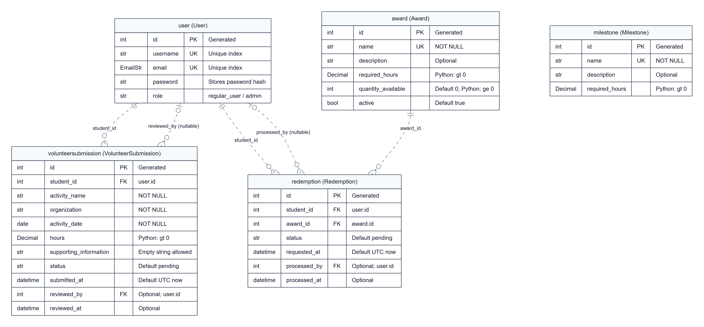
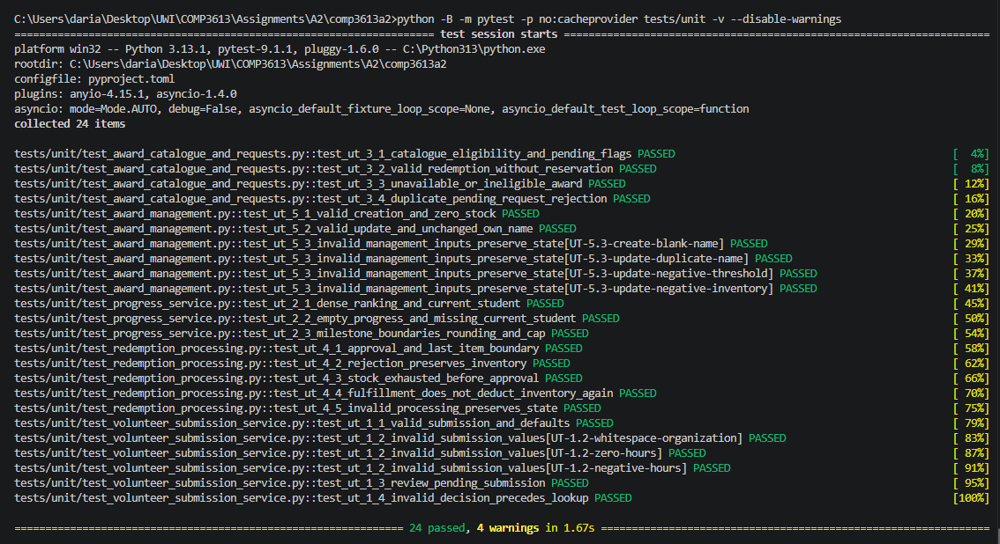
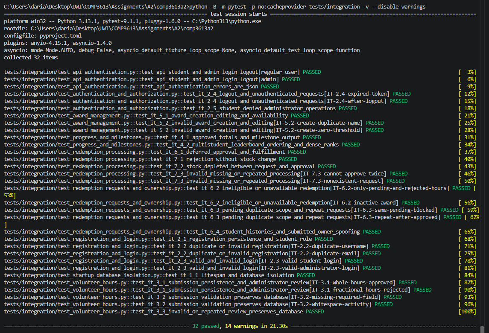
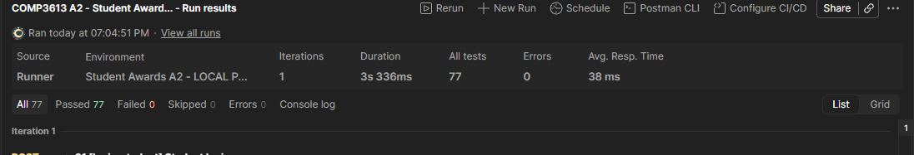
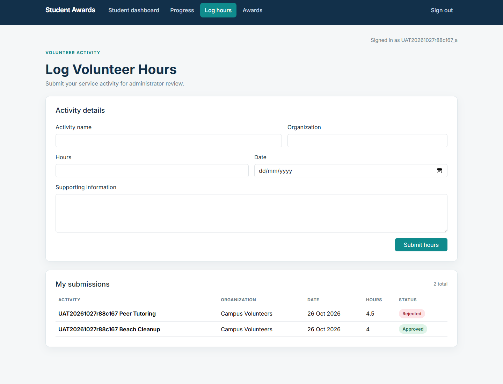
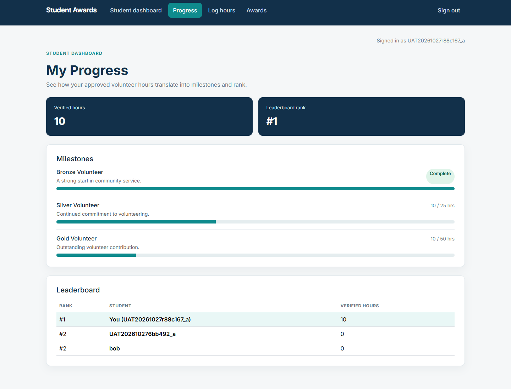
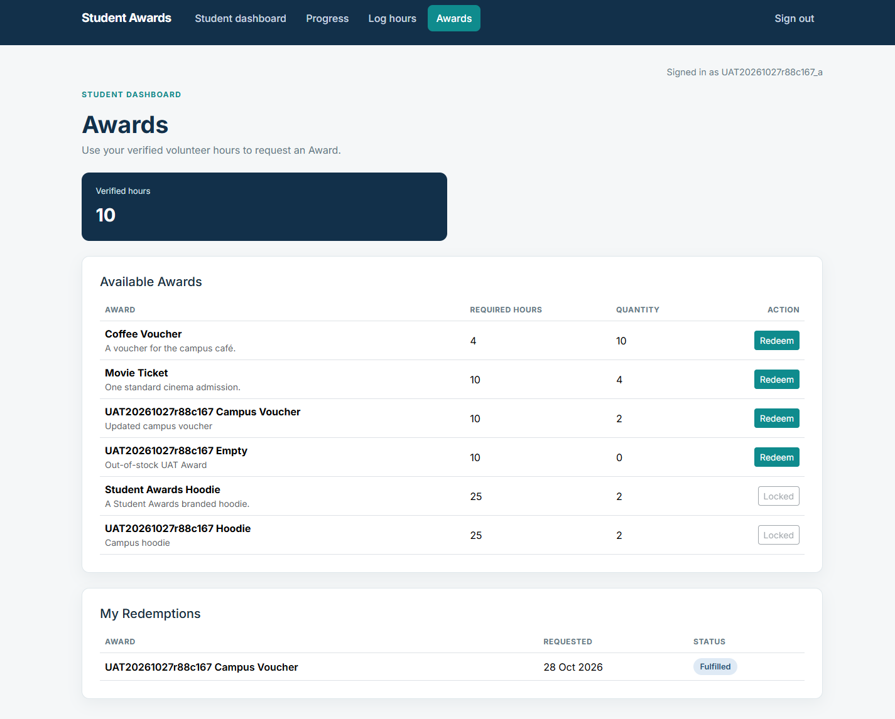

# COMP3613 Assignment 2 — Student Awards

**Student name:** Darian Jagdeo  
**Student ID:** 816044022  
**Course:** COMP3613  
**Assignment:** Assignment 2 — Test Planning, Implementation and Reporting  
**Project:** Student Awards  
**Recorded test execution date:** 27 October 2026  
**Document status:** Final A2 submission content; UAT acceptance and typed signature explicitly authorized by the student.

## 1. Project description

Student Awards is a volunteer-hours incentive application. Students submit whole or fractional volunteer hours, view approved-hour totals, track milestone progress and leaderboard rank, and request eligible Awards. Administrators review submissions, manage Award thresholds, availability and stock, and approve, reject or fulfill redemption requests.

Only approved volunteer hours contribute to progress and eligibility. Hours are cumulative and are not spent on Awards. A redemption request does not reserve stock; approval deducts one item, and fulfillment does not deduct another. Student histories are private, while the leaderboard is shared. Role-based authorization protects administrator pages and actions.

## 2. Application design

### 2.1 Use case diagram

The existing diagram represents the implemented three student workflows and their supporting administrator functions.


### 2.2 Implemented Entity Relationship Diagram



Editable source: [implemented-erd.mmd](implemented-erd.mmd). The diagram was checked against all five [SQLModel table definitions](../../app/models/__init__.py). Entity labels show actual table names and model class names.

The `user` table contains `id`, unique `username`, unique `email`, `password` and `role`. **The actual field is named `password`; it stores a password hash**, as implemented by [registration/authentication](../../app/services/auth_service.py) and [password utilities](../../app/utilities/security.py). No password values or hashes are reproduced here. Account-creation schemas assign stored roles `regular_user` and `admin`; these are displayed as student and administrator. The model's `role` column is a plain string with an empty-string default, not a database enum.

Each volunteer submission belongs to one user through `student_id`; `reviewed_by` optionally identifies its reviewing user. Each redemption belongs to one user and one Award; `processed_by` optionally identifies its processing user. A user or Award can have zero or many corresponding records. These five foreign keys are non-identifying relationships, shown with dotted lines. Nullable reviewer/processor fields allow unreviewed records. Role restrictions are application rules, not separate role-specific FK tables.

`milestone` has no stored foreign-key relationship to users. Approved-hour totals, milestone completion, leaderboard ranks and Award eligibility are calculated rather than stored as extra entities or columns. The numeric `gt`/`ge` annotations describe Python validation in the models, not invented SQL CHECK constraints. Fields marked Optional are nullable; all other columns are NOT NULL. Required supporting information may be an empty string.

### 2.3 Original wireframes and implemented refinements

The five original wireframes remain the design baseline. Illustrative names, hours and quantities are not execution results. The application uses **Awards** for the drawings' Prize/Reward terminology.

#### W1 — Log Volunteer Hours


The implementation retains the form and adds the student's submission history with Pending, Approved and Rejected statuses. Only approved entries affect verified hours.

#### W2 — Progress and Milestones


Progress uses approved totals, bounded milestone bars and dense leaderboard ranks; tied students share a rank and the current student is identified.

#### W3 — Redeem Rewards / Awards


The implementation adds confirmation and cancellation, eligibility/duplicate-pending controls, and private redemption history. Eligibility does not spend verified hours.

#### W4 — Administrator Approvals


Review details can be inspected before decisions. Approved redemptions remain actionable for fulfillment; stock is deducted on approval only.

#### W5 — Add Prize / Award Management


The implemented Award catalogue supports adding and editing Awards, changing stock and thresholds, and activating/deactivating availability.

## 3. Complete finalized test plans

The following three plans are reproduced in full, including every case, precondition, test step, criterion and original planning field. Only heading levels are adjusted for this document. Their source files remain unchanged. Blank planning result fields and future-tense statements belong to the original plans; completed execution results appear later in this report.

The integration plan records the earlier HTML-only application and authorization-status defects. Later JSON API adapters are present in the current application, and [the defect record](authorization-defects.md) documents the approved status-code correction. Its earlier intermediate run totals are historical; the final results are 24 unit and 32 integration passes. The UAT plan describes user-interface tasks as manual; actual execution used Playwright-assisted visible Edge interactions, disclosed in the complete execution report. No acceptance criteria were weakened.

### 3.1 User Acceptance Test Plan

<!-- BEGIN COMPLETE SOURCE: uat-plan.md; SHA256=f2f9766f2a27e16541305ba0714f0a8dd279a059789b51d8c0e401b2c56a24ea -->
### Student Awards User Acceptance Test Plan

**COMP3613 Assignment 2 | Version 1.1 | Status: Planning only - not executed**

Adapted from the lecturer's two-page **UAT Template.pdf**. The template's Test Case, Pre-conditions, Test Steps, Test Criteria and Success fields are retained as compact case blocks. Test Criteria are the expected success criteria; all result and acceptance fields remain blank until manual execution. There are **17 planned cases**. Combined journeys retain distinct success criteria; record any failed step separately in General Comments.

**Tester Name:** ____________________  
**Tester Position:** ____________________  
**Date of Test (DD/MM/YYYY):** ____________________  
**Browser/version:** ____________________  
**Application version/commit:** ____________________

#### Scope and preparation

Cover the three student workflows: Submit Volunteer Hours, Track Progress and Milestones, and Redeem Awards; their supporting administrator functions; and relevant access controls. Testing is manual through the existing browser interface. API testing, automated testing, database manipulation and deployment are outside this plan.

At execution time, use only `http://127.0.0.1:5000` with the A2 development database `comp3613a2/a2_development.db`. Do not use the test database or Assignment 1 deployment. The application and seeded administrator account must be available. Do not initialize, reset or clear a database as part of UAT.

Choose a unique run label **R** (for example, `UAT20261026a`). Student **A**, **B** and **C** mean new accounts named `R_a`, `R_b` and `R_c`, with unique valid email addresses and privately held passwords. Create A in 1.1; create B/C through Register when preparing 3.2. Do not write passwords in this plan or screenshots. Use separate browser profiles/private windows for student and administrator sessions, or sign out before switching users.

Execute cases in numerical order and sign in/out as needed to establish each stated actor/session precondition. Later data preconditions depend on the stated earlier outcomes; if those outcomes are unmet, leave Success blank and record the blockage in General Comments. Use only run-labelled records. For every activity use organization `Campus Volunteers`, a valid past date, and supporting information `UAT activity for R`, unless the case deliberately varies a field. Refresh the relevant page after another user changes data.

Seeded milestones should be Bronze 10 hours, Silver 25 hours and Gold 50 hours. Confirm these thresholds before execution; if different, record the discrepancy before proceeding. Drawings contain illustrative data: the controlled values below determine expected results. Approved hours are cumulative eligibility, not a balance spent on Awards. Requests do not reserve stock; approval reduces it. Repeat requests are allowed once the earlier request is no longer pending.

#### Wireframe references

- **W1:** [Log Volunteer Hours](../wireframes/log-volunteer-hours.png) - cases 2.1-2.3.
- **W2:** [Progress and Milestones](../wireframes/progress-and-milestones.png) - cases 3.1-3.2.
- **W3:** [Redeem Rewards](../wireframes/redeem-rewards.png) - cases 5.1-5.2 and student-side checks in 6.1-6.3.
- **W4:** [Administrator Approvals](../wireframes/admin-approvals.png) - cases 2.3 and 6.1-6.3.
- **W5:** [Add Prize](../wireframes/add-prize.png) - cases 4.1-4.3.

The current product calls prizes/rewards **Awards**. History tables, review details, edit/confirmation modals and fulfillment are accepted refinements documented in [the existing project report](../report.md), supplementing the drawings. Authentication cases reference existing Sign in/Register pages and role-specific navigation.

#### 1. Authentication and authorization

##### 1.1 Test Registration and Role-specific Login

**Pre-conditions:** A's username/email are unused; the local administrator exists; both browser profiles are signed out.

**Test Steps:** 1) Register A with valid details and observe the Sign in page. 2) Sign in as A and inspect Student navigation. 3) In the separate administrator profile, sign in and open Approvals and Awards.

**Test Criteria:** Registration redirects to `/login` with `Registration completed! Sign in now!`, without automatically signing A in. A's login opens `/app`, showing A's username, Progress, Log hours, Awards and Sign out, without administrator navigation. Administrator login opens `/admin`, showing the correct identity and working Approvals, Awards and Sign out navigation.

**Success (indicate with a tick):** Pass [ ] | Fail [ ]

##### 1.2 Test Invalid Login

**Pre-conditions:** Tester is signed out; A exists.

**Test Steps:** 1) Attempt to sign in as A with an incorrect password. 2) Attempt a nonexistent username with a nonempty password.

**Test Criteria:** Each attempt shows incorrect-credentials feedback and leaves the tester at Sign in; no authenticated dashboard is accessible.

**Success (indicate with a tick):** Pass [ ] | Fail [ ]

##### 1.3 Test Logout and Unauthenticated Access

**Pre-conditions:** A is signed in.

**Test Steps:** 1) Click Sign out. 2) Directly open `/app/hours`, `/app/progress`, `/app/awards`, `/admin/approvals` and `/admin/awards` using the address bar. 3) Sign in again when finished.

**Test Criteria:** Logout returns to Sign in; protected content/actions are unavailable while signed out, with an access/session message or sign-in prompt. No new records are created. HTTP status-code assertions belong to later API tests.

**Success (indicate with a tick):** Pass [ ] | Fail [ ]

##### 1.4 Test Student Restrictions

**Pre-conditions:** A is signed in as a student.

**Test Steps:** 1) Inspect A's navigation. 2) Directly open `/admin`, `/admin/approvals` and `/admin/awards`.

**Test Criteria:** Administrator navigation is absent; direct access is denied without displaying review, processing or Award-management controls or other students' private submission details.

**Success (indicate with a tick):** Pass [ ] | Fail [ ]

#### 2. Volunteer-hour submission and review

##### 2.1 Test Valid Whole and Fractional Hour Submissions

**Pre-conditions:** A is signed in with zero submissions and verified hours.

**Test Steps:** 1) Open Log hours; submit `R Beach Cleanup`, 4 hours, with the common activity details. 2) Submit `R Peer Tutoring`, 4.5 hours. 3) Refresh the page; open Progress.

**Test Criteria:** Each submission has success feedback and exactly one My submissions row with correct activity, organization, date, hours and Pending status. Values display as `4` and `4.5`. Both persist after refresh; verified hours remain zero while pending.

**Success (indicate with a tick):** Pass [ ] | Fail [ ]

##### 2.2 Test Invalid Hour Submission

**Pre-conditions:** A is signed in; note the existing submission count.

**Test Steps:** 1) Attempt to submit while omitting each required field in turn: activity, organization, hours and date; restore other fields between attempts. 2) With other fields valid, try hours `0`, then `-1`. 3) Refresh My submissions.

**Test Criteria:** Every invalid attempt is blocked with browser validation or application feedback. No additional history row appears; existing records are unchanged. Supporting information is optional and is not a required-field failure.

**Success (indicate with a tick):** Pass [ ] | Fail [ ]

##### 2.3 Test Administrator Approval and Rejection of Hours

**Pre-conditions:** Both 2.1 submissions remain Pending; administrator is signed in separately.

**Test Steps:** 1) In Approvals, View details for A's `R Beach Cleanup`; check the submitted information and Approve. 2) Refresh A's history/Progress. 3) View and Reject A's `R Peer Tutoring`; refresh both actor views.

**Test Criteria:** Review details match student, activity, organization, date, hours and supporting information. Each decision shows feedback and removes its row from the pending queue. A sees Approved for 4 hours and Rejected for 4.5 hours. Verified hours become 4 after approval and stay 4 after rejection; the pending/rejected 4.5 hours never contribute. Reviewed rows have no further review actions.

**Success (indicate with a tick):** Pass [ ] | Fail [ ]

#### 3. Progress, milestones and leaderboard

##### 3.1 Test Milestone Threshold and Approved-only Progress

**Pre-conditions:** A has 4 approved hours after 2.3; milestones match the preparation values.

**Test Steps:** 1) As A, submit `R Library Service` for 5.75 hours. Check Progress while pending, then have the administrator approve it and refresh. 2) Submit `R Event Support` for 0.25 hours; approve it and refresh Progress again.

**Test Criteria:** Pending hours do not affect progress. The first approval produces 9.75 verified hours with Bronze incomplete at `9.75 / 10`; the second produces exactly 10 and Bronze Complete. Silver and Gold remain incomplete at `10 / 25` and `10 / 50`; progress bars reflect those totals and never exceed their displayed bounds. Rejected hours remain excluded.

**Success (indicate with a tick):** Pass [ ] | Fail [ ]

##### 3.2 Test Leaderboard Ordering and Tied Ranks

**Pre-conditions:** A has 10 approved hours. Register fresh B/C through the UI. As B submit one run-labelled 10-hour activity; as C submit one 4.5-hour activity; have the administrator approve both.

**Test Steps:** 1) Open Progress as A, B and C. 2) Compare verified totals, order and rank across the full leaderboard, including any existing students.

**Test Criteria:** A/B each show 10 hours and share a rank; C shows 4.5 and ranks below them. Rows sort by decreasing approved-hour totals, then ascending username for ties. Dense rank starts at 1 and equals one plus the number of distinct higher totals, without gaps after ties. Students with no approved hours appear with 0; administrators are excluded. The current user is identified as You. Absolute ranks account for all existing students rather than assuming A/B are first.

**Success (indicate with a tick):** Pass [ ] | Fail [ ]

#### 4. Award management

##### 4.1 Test Add Awards

**Pre-conditions:** Administrator is signed in; these run-labelled Award names are unused.

**Test Steps:** 1) Open Awards, click Add Award and create `R Voucher`: description `Campus cafe voucher`, required hours 10, quantity 2, Active selected. 2) Similarly create `R Hoodie`: 25 hours, quantity 2, active; and `R Empty`: 10 hours, quantity 0, active. 3) Refresh the catalogue and view Awards as A.

**Test Criteria:** Each creation shows feedback and one persistent catalogue row with the specified values. All three active Awards appear in A's catalogue; zero inventory is accepted as a valid quantity.

**Success (indicate with a tick):** Pass [ ] | Fail [ ]

##### 4.2 Test Award Validation and Duplicate Names

**Pre-conditions:** 4.1 is complete; note catalogue values and count.

**Test Steps:** 1) In Add Award, try a blank name, required hours 0, and quantity -1 in separate otherwise-valid attempts. 2) Try creating another Award named `R Voucher`. 3) In Edit for `R Voucher`, attempt required hours 0, then cancel/reopen and attempt quantity -1. 4) Refresh the catalogue.

**Test Criteria:** Each attempt is prevented with validation or duplicate-name feedback; no extra Award is created and existing Award values remain unchanged.

**Success (indicate with a tick):** Pass [ ] | Fail [ ]

##### 4.3 Test Award Editing, Stock and Availability

**Pre-conditions:** `R Voucher` is active, quantity 2, with no requests; A has 10 approved hours.

**Test Steps:** 1) Open Edit and check prefilled values. Save name `R Campus Voucher`, description `Updated campus voucher`, threshold 25 and quantity 3. 2) Refresh A's catalogue. 3) Set threshold back to 10 and clear Active; save and refresh A's catalogue. 4) Restore Active, save and refresh again.

**Test Criteria:** Edited values persist in management and student views; at threshold 25 A sees Locked. Deactivation shows Inactive to the administrator and hides the Award from A. Reactivation restores the same renamed Award with threshold 10, quantity 3 and Redeem available to A. Subsequent cases use `R Campus Voucher`.

**Success (indicate with a tick):** Pass [ ] | Fail [ ]

#### 5. Award redemption

##### 5.1 Test Eligibility, Confirmation and Duplicate Prevention

**Pre-conditions:** 3.2 and 4.3 are complete; A/B have 10 verified hours, C has 4.5; voucher quantity is 3 and A has no requests.

**Test Steps:** 1) Compare voucher/hoodie actions as A and C. 2) As A, Redeem the voucher, inspect its modal and Cancel; inspect history. 3) Reopen and Confirm request, then refresh. 4) Navigate away/back and attempt another request if offered.

**Test Criteria:** A can redeem the 10-hour voucher but not the 25-hour hoodie; C sees both Locked. Cancel adds nothing. Confirm shows success and one Pending voucher history row with requested date. The action becomes Pending rather than Redeem, preventing a second pending request through the UI. Stock remains 3 and A's verified hours remain 10. Direct-request enforcement is covered separately by integration/API testing.

**Success (indicate with a tick):** Pass [ ] | Fail [ ]

##### 5.2 Test Student History Separation

**Pre-conditions:** A's voucher request remains Pending; B has no redemptions and has 10 verified hours.

**Test Steps:** 1) As B, inspect Log hours and Awards histories. 2) Request `R Campus Voucher` as B. 3) Refresh both A's and B's histories in their separate sessions.

**Test Criteria:** B sees B's activity and request, not A's activities or request; A sees only A's private histories. Each has one own pending voucher request. The public leaderboard remains shared; stock remains 3 because neither request is approved.

**Success (indicate with a tick):** Pass [ ] | Fail [ ]

#### 6. Redemption processing

##### 6.1 Test Redemption Approval and Fulfillment

**Pre-conditions:** A/B have separate pending voucher requests after 5.1/5.2; quantity is 3.

**Test Steps:** 1) As administrator, identify A's voucher request by student name and Approve. 2) Refresh A's history, Approvals and stock. 3) Mark A's approved request as fulfilled; refresh again.

**Test Criteria:** Approval shows feedback, A sees Approved and stock decreases exactly once to 2; B's request stays Pending. A's approved row offers Mark as fulfilled. Fulfillment shows Fulfilled in A's history, removes A's row from the actionable queue and offers no further processing. Stock stays 2 and A retains 10 verified hours.

**Success (indicate with a tick):** Pass [ ] | Fail [ ]

##### 6.2 Test Repeat Request and Administrator Rejection

**Pre-conditions:** A's first voucher request is Fulfilled; quantity remains 2.

**Test Steps:** 1) As A, request the voucher again and confirm. 2) As administrator, Reject A's new pending request. 3) Refresh A's history and the administrator queue/catalogue.

**Test Criteria:** A can create a new pending request after fulfillment. Rejection changes only the new request to Rejected, preserves the earlier Fulfilled row, removes the rejected request from the actionable queue, and leaves quantity 2. A can again see Redeem after rejection; verified hours remain 10.

**Success (indicate with a tick):** Pass [ ] | Fail [ ]

##### 6.3 Test Out-of-stock Redemption Processing

**Pre-conditions:** `R Empty` is active with threshold 10 and was created with quantity 0 in 4.1; A has 10 verified hours and no request for it. The administrator can edit its stock.

**Test Steps:** 1) As administrator, Edit `R Empty`, set quantity to 1 and Save changes. 2) As A, refresh Awards, confirm quantity 1, request `R Empty` and confirm. 3) As administrator, verify A's request is Pending, then Edit the Award, reduce quantity to 0 and save. 4) Return to Approvals, locate A's pending request and click Approve. 5) Refresh A's history, Approvals and Award stock.

**Test Criteria:** A's request is created as Pending while quantity is 1; requesting does not reserve or reduce stock. After the administrator reduces quantity to 0, attempting approval rejects the pending request with out-of-stock feedback. A sees Rejected, inventory remains exactly 0 and the request leaves the actionable queue. Inventory never becomes negative.

**Success (indicate with a tick):** Pass [ ] | Fail [ ]

#### Recording and acceptance (complete only after execution)

For each executed case, tick Pass only when all Test Criteria are observed; otherwise tick Fail and record the case ID, actual result, expected result, evidence reference and any retest outcome in General Comments. Leave unexecuted/blocked cases unticked. Capture relevant screens without passwords, tokens or unrelated personal data. Navigation checks already performed are not results for this plan.

Retain the run-labelled data for evidence; use a new run label and fresh student accounts for a repeat run rather than deleting existing records. An overall acceptance decision may be made only after all planned cases are executed, failures are resolved/retested, and the tester confirms the workflows meet the criteria. Do not pre-fill acceptance or signature.

**General Comments:**

______________________________________________________________________

______________________________________________________________________

**Accepted | Rejected:** ____________________

**Signature:** ____________________
<!-- END COMPLETE SOURCE: uat-plan.md -->

### 3.2 Unit Test Plan

<!-- BEGIN COMPLETE SOURCE: unit-test-plan.md; SHA256=8e0a32c483669a3ca8ee98c3c3646296c3c035cf5f64581a005ff1af369bcabe -->
### Student Awards Unit Test Plan

**COMP3613 Assignment 2 | Version 1.1 | Status: Planning only - not executed**

This plan addresses the assignment's requirement for testing modules in isolation, with later implementation in pytest. It follows the case-block style and Pre-conditions, Test Criteria and Success terminology of the approved [UAT plan](uat-plan.md). There are **19 planned cases**; parameterized inputs within a case are separate invocations of the same rule, not additional plan IDs. All result fields remain blank.

#### Scope and preparation

Test the existing volunteer-submission, progress and Award services independently. Use in-memory SQLModel objects, repository mocks or small fakes; never construct a real Session, engine or HTTP client. These unit tests require neither the development nor the future integration-test database, running server, seeded users or environment secrets. Do not import `app.main` or `app.database` in the future unit-test fixtures.

Common inputs: student ID `101`, administrator ID `900`, activity date `2026-10-20`, activity `Beach Cleanup`, organization `Campus Volunteers`, supporting information `Confirmed by organizer`. All hours/thresholds use `Decimal` values. Default Award: ID `201`, name `Campus Voucher`, required hours `10`, quantity `2`, active `True`. Default submission/redemption IDs are `301`/`401`, initially `pending`. Each invocation receives fresh objects and mocks; cases do not depend on previous cases or UAT data.

Mock persistence methods to return the supplied object without saving it. For rejection paths, check that no create/save method is called and existing objects remain unchanged. Where clocks matter, replace the `datetime` name in the specific service module with a controlled clock returning a fixed timestamp. Do not depend on wall-clock equality.

#### Code references and unit boundaries

- [VolunteerSubmissionService](../../app/services/volunteer_submission_service.py): `submit`, `review`.
- [ProgressService](../../app/services/progress_service.py): `get_student_progress`.
- [AwardService](../../app/services/award_service.py): `get_student_awards`, `request_redemption`, `create_award`, `update_award`, `process_redemption`; numeric rules are shared through `_validate_award_values`.
- Integration-only aggregate references: [VolunteerSubmissionRepository.approved_hours_total](../../app/repositories/volunteer_submission.py) and [AwardRepository.verified_hours](../../app/repositories/award.py).

Approval/rejection/fulfillment cases test business transitions with a supplied administrator ID. They do not establish administrator authorization: routers enforce that using `AdminDep`. Authentication, authorization, rendered pages, persistence, SQL row filtering/ordering, unique/foreign-key constraints and transaction concurrency require later integration/API tests or UAT. Read-only dashboard composition and simple list-forwarding methods are outside this focused business-rule suite.

Approved-only filtering/summation is verified with real rows in integration case IT-4.1; no wrapper-delegation or mocked SQL-shape cases are retained here. Missing processing/update IDs are covered by IT-7.3/IT-5.2. Orphan references are checked through foreign-key enforcement in IT-1.1 rather than fabricating invalid persisted relationships.

#### 1. Volunteer-hour submission and review

##### UT-1.1 Test Valid Submission and Defaults

**Function/service:** `VolunteerSubmissionService.submit`.

**Purpose:** Accept positive whole/fractional hours and normalize text.

**Pre-conditions and test inputs:** Common activity; hours `4`, `4.5` and `0.01` in separate invocations; padded activity/organization; supporting information padded or blank.

**Mocked dependencies:** `VolunteerSubmissionRepository.create`, returning its argument.

**Test Criteria (expected result):** One created object has the supplied student/date/hours, trimmed text, status `pending`, a submission timestamp and null review metadata; blank supporting information becomes an empty string. The returned object is the repository result. The service accepts any positive decimal; browser quarter-hour restrictions are not a service rule.

**Test Type:** Unit - service with mocked persistence, not integration.

**Success:** Pass [ ] | Fail [ ]

##### UT-1.2 Test Invalid Submission Values

**Function/service:** `VolunteerSubmissionService.submit`.

**Purpose:** Reject missing meaningful text and nonpositive hours.

**Pre-conditions and test inputs:** Otherwise-valid activity; vary activity name or organization to empty/whitespace, or hours to `0`/`-0.25`, one invalid value at a time.

**Mocked dependencies:** Volunteer-submission repository.

**Test Criteria (expected result):** `ValueError` identifies required activity/organization or positive hours as appropriate; `create` is never called.

**Test Type:** Unit - service validation, not integration.

**Success:** Pass [ ] | Fail [ ]

##### UT-1.3 Test Approve and Reject Pending Hours

**Function/service:** `VolunteerSubmissionService.review`.

**Purpose:** Apply valid decisions and record review metadata.

**Pre-conditions and test inputs:** Pending submission; decisions `approved`, `rejected`, and padded/mixed-case equivalents; administrator ID `900`.

**Mocked dependencies:** Repository `get_by_id`/`save`; module clock.

**Test Criteria (expected result):** Decision is normalized; status becomes approved/rejected; reviewer ID and fixed review timestamp are set. `save` receives the changed submission once, and its result is returned; activity details/hours are unchanged.

**Test Type:** Unit - service state transition, not integration.

**Success:** Pass [ ] | Fail [ ]

##### UT-1.4 Test Invalid Review or Previously Reviewed Submission

**Function/service:** `VolunteerSubmissionService.review`.

**Purpose:** Prevent unsupported decisions and repeat review.

**Pre-conditions and test inputs:** Separate variants: invalid decision `pending` or empty; valid decision with missing submission; valid decision for already `approved` or `rejected` submission.

**Mocked dependencies:** Repository lookup/save.

**Test Criteria (expected result):** Appropriate `ValueError` reports invalid decision, missing submission or pending-only review. No save or object mutation occurs; invalid decisions are rejected before lookup.

**Test Type:** Unit - service rejection paths, not integration.

**Success:** Pass [ ] | Fail [ ]

#### 2. Progress, milestones and leaderboard

##### UT-2.1 Test Dense Ranking and Current Student

**Function/service:** `ProgressService.get_student_progress`.

**Purpose:** Assign consecutive ranks to distinct totals and identify the current student.

**Pre-conditions and test inputs:** Already ordered rows `(101, Alice, 10)`, `(102, Ben, 10)`, `(103, Cara, 4.5)`, `(104, Dan, 0)`; current student `102`; no milestones.

**Mocked dependencies:** `ProgressRepository.leaderboard_totals` and `list_milestones`.

**Test Criteria (expected result):** Ranks are `1, 1, 2, 3`; only Ben has `is_current=True`; current hours/rank are `10`/`1`; row order is preserved. Repository SQL ordering, tie-name sorting and administrator exclusion are integration concerns, not behavior performed by this service.

**Test Type:** Unit - ranking transformation over fake ordered rows, not integration.

**Success:** Pass [ ] | Fail [ ]

##### UT-2.2 Test Empty Progress and Missing Current Student

**Function/service:** `ProgressService.get_student_progress`.

**Purpose:** Handle empty collections and an absent current-student row.

**Pre-conditions and test inputs:** Empty leaderboard, or only another student's row; current ID `101`. Exercise an empty milestone list and a valid 10-hour milestone.

**Mocked dependencies:** Progress repository read methods.

**Test Criteria (expected result):** Current verified hours default to `0` and rank to `None`; no returned row is current. Empty lists are handled without failure; an existing milestone is incomplete at 0% when the current student is absent.

**Test Type:** Unit - empty/default service results, not integration.

**Success:** Pass [ ] | Fail [ ]

##### UT-2.3 Test Milestone Boundaries, Rounding and Cap

**Function/service:** `ProgressService.get_student_progress`.

**Purpose:** Calculate completion and display percentages accurately.

**Pre-conditions and test inputs:** One current-student row; threshold `10` with totals `0`, `9.75`, `10`, `10.25`; also total `1` with threshold `3`. Milestones have valid positive thresholds.

**Mocked dependencies:** Progress repository returning the controlled total and milestone.

**Test Criteria (expected result):** Percentages are respectively `0`, `97.5`, `100`, `100`, and `33.3`; completion is false below the threshold and true at/above it. Name, description and threshold are preserved. No percentage exceeds 100.

**Test Type:** Unit - derived milestone calculations, not integration.

**Success:** Pass [ ] | Fail [ ]

#### 3. Award catalogue and redemption requests

##### UT-3.1 Test Catalogue Eligibility and Pending Flags

**Function/service:** `AwardService.get_student_awards`.

**Purpose:** Present correct eligibility without confusing it with request status.

**Pre-conditions and test inputs:** Verified total `10`; active Awards with thresholds `4`, `10`, `25`; pending flag true for the 10-hour Award only. Include a separate empty-catalogue variant.

**Mocked dependencies:** Award repository `verified_hours`, `list_active`, `has_pending`, `list_student_redemptions`.

**Test Criteria (expected result):** Eligibility is true/true/false; pending flags match the corresponding student/Award lookup. Returned hours and history match repository results; empty catalogue returns an empty Award list. Actual inactive-row filtering remains the repository's integration responsibility.

**Test Type:** Unit - service composition and threshold comparisons, not integration.

**Success:** Pass [ ] | Fail [ ]

##### UT-3.2 Test Valid Redemption Request Without Stock Reservation

**Function/service:** `AwardService.request_redemption`.

**Purpose:** Accept eligible requests at/above the threshold without spending hours or stock.

**Pre-conditions and test inputs:** Active Award, threshold `10`, quantity `1`; verified total `10` or `10.25`; no pending request. A prior nonpending request may be represented by `has_pending=False`.

**Mocked dependencies:** Award repository lookup, verified total, pending check and `create_redemption`.

**Test Criteria (expected result):** Creates one pending redemption for student `101`/Award `201`, with request timestamp and null processing metadata; returns repository result. Quantity remains 1; no processing/save operation reduces inventory. The student/Award pair is passed to `has_pending`; SQL recognition of prior statuses needs integration testing.

**Test Type:** Unit - request business rules with fake persistence, not integration.

**Success:** Pass [ ] | Fail [ ]

##### UT-3.3 Test Missing, Inactive or Ineligible Award

**Function/service:** `AwardService.request_redemption`.

**Purpose:** Refuse unavailable Awards and insufficient verified hours.

**Pre-conditions and test inputs:** Separate variants: lookup returns `None`; inactive Award; active 10-hour Award with total `9.75`.

**Mocked dependencies:** Award repository read/create methods.

**Test Criteria (expected result):** `ValueError` reports unavailable Award or insufficient hours, as appropriate. No redemption is created and Award stock is unchanged.

**Test Type:** Unit - service rejection paths, not integration.

**Success:** Pass [ ] | Fail [ ]

##### UT-3.4 Test Duplicate Pending Request Rejection

**Function/service:** `AwardService.request_redemption`.

**Purpose:** Prevent creation when the repository reports an existing pending request.

**Pre-conditions and test inputs:** Active eligible Award; `has_pending(101, 201)` returns true.

**Mocked dependencies:** Award repository lookup/total/pending/create methods.

**Test Criteria (expected result):** Raises the pending-request `ValueError`; `create_redemption` is not called and inventory is unchanged. This checks the sequential service guard, not concurrent duplicate prevention.

**Test Type:** Unit - duplicate guard with mocked lookup, not integration.

**Success:** Pass [ ] | Fail [ ]

#### 4. Administrator redemption processing

##### UT-4.1 Test Approval and Last-item Boundary

**Function/service:** `AwardService.process_redemption`.

**Purpose:** Approve pending requests and deduct exactly one item.

**Pre-conditions and test inputs:** Pending redemption; stock `2` or `1`; decision `approved`, including a padded/mixed-case variant; administrator `900`.

**Mocked dependencies:** Award repository redemption/Award lookups and `save_processing`; module clock.

**Test Criteria (expected result):** Status becomes approved; stock becomes 1 or 0; processor/fixed timestamp are recorded. Saves redemption and Award together once; returns `Redemption approved.`.

**Test Type:** Unit - state/inventory mutation, not transaction integration.

**Success:** Pass [ ] | Fail [ ]

##### UT-4.2 Test Rejection Without Inventory Change

**Function/service:** `AwardService.process_redemption`.

**Purpose:** Reject a pending request without consuming stock.

**Pre-conditions and test inputs:** Pending redemption; stock `2` or `0`; decision `rejected`.

**Mocked dependencies:** Award repository lookups/save; module clock.

**Test Criteria (expected result):** Status becomes rejected; stock is unchanged; processor/time are set. Saves once and returns `Redemption rejected.`.

**Test Type:** Unit - rejection transition, not integration.

**Success:** Pass [ ] | Fail [ ]

##### UT-4.3 Test Stock Exhausted Before Approval

**Function/service:** `AwardService.process_redemption`.

**Purpose:** Reject approval when current stock is zero.

**Pre-conditions and test inputs:** Existing pending request made earlier while stock was available; Award lookup now returns quantity `0`; decision `approved`.

**Mocked dependencies:** Award repository lookups/save; module clock.

**Test Criteria (expected result):** Request becomes rejected rather than approved; inventory remains exactly 0; processor/time are set and saved once. Returns `Request rejected because the Award is out of stock.`. This models current stock at processing time without replaying creation or database changes.

**Test Type:** Unit - stock-exhaustion branch, not concurrency integration.

**Success:** Pass [ ] | Fail [ ]

##### UT-4.4 Test Fulfillment Without Second Stock Deduction

**Function/service:** `AwardService.process_redemption`.

**Purpose:** Complete an approved request without consuming another item.

**Pre-conditions and test inputs:** Approved redemption; quantity `1`; decision `fulfilled`.

**Mocked dependencies:** Award repository lookups/save; module clock.

**Test Criteria (expected result):** Status becomes fulfilled; processor/time are updated; quantity stays 1. Calls `save_processing` with the redemption only and returns `Redemption marked as fulfilled.`.

**Test Type:** Unit - fulfillment state transition, not integration.

**Success:** Pass [ ] | Fail [ ]

##### UT-4.5 Test Invalid Processing Transitions

**Function/service:** `AwardService.process_redemption`.

**Purpose:** Prevent unsupported actions and repeat processing.

**Pre-conditions and test inputs:** Status/decision pairs: pending/fulfilled, approved/approved, approved/rejected, rejected/approved, fulfilled/fulfilled, pending/unknown. Valid referenced Award exists.

**Mocked dependencies:** Award repository lookups/save.

**Test Criteria (expected result):** Raises `ValueError` for an action invalid for the current status. No save occurs; redemption status/metadata and quantity remain unchanged.

**Test Type:** Unit - state-machine rejection paths, not integration.

**Success:** Pass [ ] | Fail [ ]

#### 5. Award management and validation

##### UT-5.1 Test Valid Award Creation and Zero Stock

**Function/service:** `AwardService.create_award`.

**Purpose:** Normalize Award details and accept valid inventory boundaries.

**Pre-conditions and test inputs:** Padded unique name; padded or blank description; required hours `0.25`; quantity `0` or `2`; active true/false variants.

**Mocked dependencies:** Award repository `get_by_name` returns `None`; `save_award` returns its argument.

**Test Criteria (expected result):** Saves one Award with trimmed name/description, blank description converted to `None`, and exact threshold, inventory and active flag. Name lookup uses trimmed text; returns the saved Award. Zero stock is valid.

**Test Type:** Unit - creation rules without persistence, not integration.

**Success:** Pass [ ] | Fail [ ]

##### UT-5.2 Test Valid Award Update and Unchanged Own Name

**Function/service:** `AwardService.update_award`.

**Purpose:** Update all managed fields while allowing the same Award to retain its name.

**Pre-conditions and test inputs:** Existing Award; valid padded name/description, threshold `25`, quantity `0`, active false. Variants: retain own name, with duplicate lookup returning the same ID; rename to an unused name, lookup returning `None`.

**Mocked dependencies:** Award repository `get_award`, `get_by_name`, `save_award`.

**Test Criteria (expected result):** Saves the existing Award once with normalized text and supplied threshold/stock/active state; no replacement entity is created. Keeping its own name is accepted; repository result is returned.

**Test Type:** Unit - update/availability rules, not integration.

**Success:** Pass [ ] | Fail [ ]

##### UT-5.3 Test Invalid Award Management Inputs

**Function/service:** `AwardService.create_award`; separately, `update_award`, exercising `_validate_award_values` through the public methods.

**Purpose:** Reject invalid names, thresholds and inventory without mutation or saving.

**Pre-conditions and test inputs:** Vary one field at a time: empty/whitespace name; padded duplicate name; threshold `0`/`-0.25`; quantity `-1`. Other values are valid. For update, the target exists; duplicate-name lookup returns a different Award ID. Numeric variants use a permitted name.

**Mocked dependencies:** Award repository lookups and `save_award`, with fresh objects for each operation/variant.

**Test Criteria (expected result):** Raises the matching required-name, duplicate-name, positive-hours or nonnegative-quantity `ValueError`. No save occurs and existing fields remain unchanged. Check trimmed duplicate lookup names. Do not duplicate public numeric cases with private-helper tests; database uniqueness is an integration concern.

**Test Type:** Unit - parameterized service validation, not integration.

**Success:** Pass [ ] | Fail [ ]

#### Implementation considerations and later coverage

- Use repository-spec mocks or small purpose-built fakes. Keep real business logic in the method under test; do not reproduce it in a fake. Verify observable results and writes, not every incidental read or call order.
- Approved-only summation lives in two repository aggregate methods. Integration case IT-4.1 supplies actual approved/pending/rejected rows for multiple students and verifies totals, including no approved rows. Mock-returned totals in the retained service units do not prove SQL exclusions.
- `ProgressService` trusts repository ordering and valid positive milestone thresholds. Feed ordered rows; do not invent sorting, administrator filtering or zero-threshold recovery in the service. Invalid milestone persistence/model validation belongs outside this service plan.
- SQLModel table field declarations are not proof of database CHECK constraints or automatic validation on every construction path. Assert explicit service rules here; check persistence constraints separately. Request parsing, missing HTTP fields and browser numeric steps are also outside these units.
- Module-local clocks and mutable records require careful fixture setup. Return fresh SQLModel objects per variant; patch the service's imported clock, not unrelated global time.
- Service stock checks and pending-request guards are sequential. Unit mocks cannot establish atomic commits, rollback, concurrent inventory safety, SQL uniqueness, or repeat-request status filtering. Reserve those guarantees for isolated database integration tests.
- All variants will eventually be runnable through pytest with readable parameter IDs; no test implementation, execution, screenshots or results are included at this planning stage.

**General Comments / Review Notes:**

______________________________________________________________________

**Reviewed by:** ____________________  
**Review date (DD/MM/YYYY):** ____________________
<!-- END COMPLETE SOURCE: unit-test-plan.md -->

### 3.3 Integration Test Plan

<!-- BEGIN COMPLETE SOURCE: integration-test-plan.md; SHA256=ca1952439175ee5318aca379a5f3dbda99760070d530b5620920b04ce4bc3e86 -->
### Student Awards Integration Test Plan

**COMP3613 Assignment 2 | Version 1.1 | Status: Planning only - not executed**

This plan addresses the Assignment 2 requirement to cover main application functionality with integration tests implemented later in pytest. It follows the case-block style and Pre-conditions, Test Steps, Test Criteria and Success terminology of the approved [UAT plan](uat-plan.md) and [Unit Test Plan](unit-test-plan.md). There are **20 planned cases**. Parameterized variants are separate invocations under the same plan ID. All results remain blank.

#### Scope and integration boundary

Exercise real FastAPI handlers, authentication/session dependencies, services, repositories, SQLModel tables and SQLite persistence together. Future pytest tests will use FastAPI's in-process `TestClient` and real test-database sessions; no running development server or external network is required. Do not mock business rules, repositories or authorization, or substitute an always-authenticated dependency. This differs from the unit plan's isolated service logic and mocked repositories.

The application currently exposes HTML/form workflows, not domain JSON APIs. Submit form-encoded data. Inspect redirects with automatic redirect following disabled, then explicitly GET the Location to check flash messages and rendered results. Successful form actions normally return **303**, not JSON/201. Typed form-validation failures normally return **422**; caught service `ValueError` failures return **303** plus feedback. Read database state in a new session after each action to verify committed changes rather than a cached object.

#### Database isolation, startup and repeatability

1. Before pytest collection or any application/security-module import, select `ENV=test` in a fresh process. Load `.env.test`, falling back only to `.env.test.example`. Do not use development credentials or the development server. Clear incompatible inherited overrides; never bypass the profile guard by selecting production.
2. Before connection, client startup or cleanup, require effective mode `test`, SQLite backend and the resolved target **`comp3613a2/a2_test.db`**. Verify the actual application engine points there. Reject development/remote targets and stop if isolation cannot be established. Do not log secrets or connection credentials.
3. Use `TestClient(app)` as a context manager so lifespan startup runs. `app.main.lifespan`, recovery middleware, `app.database.get_session` and CLI-session helpers all reach the configured engine. The imported engine reference in `app.routers.server_config` must also be the test engine. A request dependency override alone is insufficient. If modules already hold a development engine, abort and restart the pytest process with the test profile.
4. Plan function-scoped setup/teardown against this dedicated disposable test schema only. Reset test tables/rows with foreign-key-safe cleanup after the target guard; never reset another database or use `manage.py init` to provision test data. For IT-1.1 start with an empty test schema so lifespan must create the tables. For other cases, fixtures create the schema and insert only that case's baseline records.
5. Every case and parameter variant owns its users, activities, Awards and requests; capture generated IDs instead of relying on fixed IDs or earlier cases. Use real password hashes, fixture-held dummy passwords and separate cookie jars for each actor. Close clients/sessions and release connections in teardown, including after failures. Run serially: the current configuration has one fixed test file, so parallel workers must not share it.
6. Application repositories commit internally; a simple outer-session rollback is not sufficient cleanup. Verify teardown/reset removes each case's committed data. Any schema-recovery retry must remain confined to the same test engine.

**Common fixture data:** student **A** and student **B** have role `regular_user`; administrator **M** has role `admin`. Use unique usernames/emails per case, with no demo accounts assumed. Unless varied, activity data is `Beach Cleanup`, `Campus Volunteers`, date `2026-10-20`, hours `4`, supporting information `Fixture activity`. Award **V** is active, requires `10` hours and has quantity `2`. Hours and thresholds use `Decimal`. Each case states its own approved totals and states; preparation may insert real fixture rows directly into the test database, but the action under test uses the listed HTTP routes.

#### Implementation references and known limits

- [Configuration](../../app/config.py), [database/engine](../../app/database.py) and [application lifespan/error handlers](../../app/main.py).
- [Registration](../../app/routers/register.py), [login](../../app/routers/login.py), [logout](../../app/routers/logout.py), [authorization](../../app/dependencies/auth.py) and [token utilities](../../app/utilities/security.py).
- [Hour submission](../../app/routers/volunteer_submissions.py), [administrator review/processing](../../app/routers/admin_reviews.py), [progress](../../app/routers/progress.py), [student Awards](../../app/routers/awards.py) and [Award management](../../app/routers/admin_awards.py), using their real services/repositories.

**Known HTTP issue:** `AdminDep` raises 401 rather than 403 for a signed-in nonadministrator, and the global 401 handler renders `401.html` without an explicit error status, currently implying HTTP 200. Access-control criteria below require denied content/actions and unchanged database state; capture the status as a known defect, not evidence of successful authorization. Do not silently claim correct 401/403 behavior. Application fixes or revised HTTP-contract assertions require a later decision.

SQLite results establish behavior only for this SQLite configuration. They do not establish PostgreSQL numeric precision, locking, isolation, concurrent duplicate prevention or atomic stock updates under competing requests. Those guarantees require separately authorized PostgreSQL integration testing; no such connection is part of this plan.

Keep combined journeys as short scenario tests or named parameter variants, with fresh fixtures for every invocation. The full arithmetic/validation boundary sweeps remain in the unit plan; integration uses representative values plus committed-state, HTTP and ownership assertions. Use the listed combinations rather than every possible input cross-product. Label every variant so a failure identifies its scenario.

#### 1. Startup and isolated database baseline

##### IT-1.1 Test Lifespan Initialization and Relational Baseline

**Purpose and components:** Verify configuration, lifespan and SQLite schema/connection settings work together.

**Pre-conditions and test data:** Confirmed test engine; empty disposable test schema; no fixture users yet.

**Test Steps:** 1) Enter the client context. 2) Inspect created table names and `PRAGMA foreign_keys` through a real test connection. 3) GET `/health`. 4) Attempt a validly shaped submission referencing a nonexistent user in a separate test transaction; roll back its expected constraint error.

**Test Criteria (expected results):** All five domain tables exist; foreign-key enforcement is 1; health returns 200 with `{"ok":true}`. Orphan insertion raises a database integrity error and leaves no row. Startup/recovery/session paths use only the guarded test engine; the health response alone is not proof of database readiness.

**Database / HTTP interactions:** SQLite DDL/metadata, foreign-key enforcement, rejected INSERT and rollback; GET `/health`.

**Test Type:** Integration - lifecycle, HTTP and real database.

**Success:** Pass [ ] | Fail [ ]

#### 2. Registration, authentication and authorization

##### IT-2.1 Test Registration Persistence and Student Role

**Purpose and components:** Join registration handler, auth service, user repository and password hashing.

**Pre-conditions and test data:** No matching user; valid unique username/email and a fixture password. Include an extra submitted `role=admin` field.

**Test Steps:** 1) POST `/register`. 2) GET the redirect destination. 3) Read the new user in an independent session.

**Test Criteria (expected results):** 303 to `/login` with `Registration completed! Sign in now!`; exactly one user persists. Password is hashed and verifies against the fixture password; stored role is `regular_user`, ignoring attempted role escalation. Registration does not issue an authenticated access-token cookie.

**Database / HTTP interactions:** Form registration, flash-session cookie and user INSERT/SELECT; no authentication bypass.

**Test Type:** Integration - HTTP, hashing and persistence.

**Success:** Pass [ ] | Fail [ ]

##### IT-2.2 Test Duplicate or Invalid Registration

**Purpose and components:** Exercise registration validation, database uniqueness and error handling.

**Pre-conditions and test data:** Existing user; independent variants duplicate its username, duplicate its email, or supply an invalid email with otherwise-new data.

**Test Steps:** 1) POST `/register` with the variant. 2) GET the redirect destination and inspect users through a fresh session.

**Test Criteria (expected results):** 303 to `/register`, generic current registration-error feedback, and no added/altered user. Duplicate attempts preserve the original password/role. Invalid-email feedback is currently generic rather than a dedicated email-validation message.

**Database / HTTP interactions:** User lookup/attempted INSERT, constraint rollback where applicable and post-request SELECT; registration requests.

**Test Type:** Integration - validation/persistence failure paths.

**Success:** Pass [ ] | Fail [ ]

##### IT-2.3 Test Valid and Invalid Login

**Purpose and components:** Verify password checks, JWT cookie issuance and role-specific routing.

**Pre-conditions and test data:** Real A/M users; independent variants valid student, valid administrator, incorrect password and unknown username. Each starts with a fresh client.

**Test Steps:** 1) POST `/login`. 2) Follow its Location. 3) For successful variants, request the corresponding protected dashboard.

**Test Criteria (expected results):** Valid A/M logins redirect to `/app` or `/admin`, set the access-token cookie and show the matching dashboard identity. Invalid credentials redirect to `/login` with error feedback and no access-token issuance. Local test cookies have HttpOnly and SameSite=Lax settings; user records remain unchanged.

**Database / HTTP interactions:** User SELECT, password verification and real cookie-authenticated dashboard reads.

**Test Type:** Integration - authentication and HTTP/database dependencies.

**Success:** Pass [ ] | Fail [ ]

##### IT-2.4 Test Logout and Unauthenticated Requests

**Purpose and components:** Exercise cookie removal, token validation and protected-route dependencies.

**Pre-conditions and test data:** A exists; separate variants use no cookie, a tampered token, an already-expired test-signed token, or A's client after real logout. Use test-only secrets without recording tokens.

**Test Steps:** 1) For the logout variant, log in and GET `/logout`. 2) Attempt GET `/app/hours` and POST `/app/hours` with otherwise-valid data.

**Test Criteria (expected results):** Logout redirects to `/login` and removes the cookie. Every variant denies protected content/action and creates no submission. Record the known unauthorized-status issue described above; do not infer permission from HTTP 200 alone.

**Database / HTTP interactions:** Cookie/JWT verification and denied read/write requests; fresh-session count comparison.

**Test Type:** Integration - authentication failures through real dependencies.

**Success:** Pass [ ] | Fail [ ]

##### IT-2.5 Test Student Denial of Administrator Operations

**Purpose and components:** Verify `AdminDep` protects both views and mutations.

**Pre-conditions and test data:** Authenticated A; B has one pending submission and redemption; V exists. Snapshot their records.

**Test Steps:** 1) GET `/admin`, `/admin/approvals`, `/admin/awards`. 2) POST valid-looking forms to create/edit Awards, review B's submission and process B's redemption using their real IDs.

**Test Criteria (expected results):** Administrator content and actions are denied; no private review data is exposed, no Award is added/changed, no decision metadata changes and stock is untouched. Capture the known status defect separately.

**Database / HTTP interactions:** All existing administrator GET/POST route families with A's real cookie; before/after SELECT snapshots.

**Test Type:** Integration - route authorization and write prevention.

**Success:** Pass [ ] | Fail [ ]

#### 3. Volunteer submissions and administrator review

##### IT-3.1 Test Submission, Persistence and Administrator Review

**Purpose and components:** Join form parsing, submission/review services, repositories and both actor views.

**Pre-conditions and test data:** Real A/M sessions; A starts with no submissions. Independent (hours, decision) variants: (4, approved), (4.5, approved), (4.5, rejected). Use padded text and include a blank optional supporting-information variant.

**Test Steps:** 1) As A, POST `/app/hours`; follow the redirect and reload history. 2) Read the committed row in a fresh session and inspect its details in M's Approvals. 3) POST its review decision; reload both views and query fresh state.

**Test Criteria (expected results):** Submission returns 303/success and persists one A-owned Pending row with normalized data, correct hours/date, timestamp and null review metadata. History survives reload and formats 4/4.5 cleanly. Review returns 303/feedback, persists M/time and the chosen status, removes the pending row and updates A's history. Verified hours equal submitted hours only when approved; otherwise 0.

**Database / HTTP interactions:** Hour POST/INSERT, separate history/queue SELECTs, review POST/UPDATE and approved-total reads.

**Test Type:** Integration - independent request-to-review persistence journeys.

**Success:** Pass [ ] | Fail [ ]

##### IT-3.2 Test Submission Parsing and Validation Failures

**Purpose and components:** Distinguish HTTP parsing failures from service validation and prevent writes.

**Pre-conditions and test data:** Authenticated A; snapshot submission count. Independent variants omit one representative required field, use malformed date/nonnumeric hours, whitespace activity/organization, or hours `0`/`-0.25`.

**Test Steps:** 1) POST the variant to `/app/hours`. 2) Inspect the immediate response, follow only redirects, and query submissions.

**Test Criteria (expected results):** Missing/malformed typed fields produce 422; service-invalid values produce 303 with validation feedback. No variant inserts a row or alters existing data. HTTP tests do not assume browser quarter-hour restrictions are server rules.

**Database / HTTP interactions:** Form binding, service rejection and no-write verification via SELECT.

**Test Type:** Integration - HTTP/schema/service validation boundaries.

**Success:** Pass [ ] | Fail [ ]

##### IT-3.3 Test Invalid or Repeated Submission Review

**Purpose and components:** Prevent invalid review requests from changing persisted decisions.

**Pre-conditions and test data:** M signed in; independent variants use a nonexistent integer submission ID, a pending row with an invalid decision, or an approved/rejected row receiving a second decision.

**Test Steps:** 1) POST the review route. 2) GET the redirect and compare database snapshots.

**Test Criteria (expected results):** 303 with appropriate missing-row, decision or pending-only feedback. No row, hours, reviewer or timestamp changes; no replacement record appears.

**Database / HTTP interactions:** Existing review endpoint with real lookup/state guards; post-request SELECT.

**Test Type:** Integration - persisted invalid-operation prevention.

**Success:** Pass [ ] | Fail [ ]

#### 4. Approved progress, milestones and leaderboard

##### IT-4.1 Test Approved Totals and Milestone Output

**Purpose and components:** Verify real aggregate queries feed progress, milestones and Award eligibility consistently.

**Pre-conditions and test data:** A has approved 4 and 0.5, pending 8, rejected 6; B has approved 20. Milestones have thresholds 4.5 and 10, inserted in reverse order. Independent variants give A no approved rows or provide no milestones.

**Test Steps:** 1) Read `VolunteerSubmissionService.verified_hours` and `AwardRepository.verified_hours` using real sessions. 2) GET A's `/app/progress` and `/app/awards`; compare totals and milestone context/rendering.

**Test Criteria (expected results):** All A totals are 4.5, or 0 with no approved rows; pending/rejected/B-owned hours are excluded. Milestones sort by threshold: at 4.5, the first is Complete/100% and the second incomplete/45%; at 0, both are incomplete/0%. Empty milestones render their empty state. Full below/at/above/cap arithmetic is covered by UT-2.3, not repeated here.

**Database / HTTP interactions:** Actual SUM/COALESCE/student-status filters, milestone-order SELECT and progress/Award GETs.

**Test Type:** Integration - SQL aggregation, calculation and template wiring.

**Success:** Pass [ ] | Fail [ ]

##### IT-4.2 Test Multi-student Leaderboard Ordering and Dense Ranks

**Purpose and components:** Verify repository joins/order and service ranking together.

**Pre-conditions and test data:** Students Alice/Ben each have approved 10, Cara 4.5, Dan no submissions, Eve only rejected/pending submissions. M has approved 50. Insert users/activities in a deliberately different order.

**Test Steps:** 1) GET `/app/progress` as Ben and inspect the leaderboard table/context. 2) Read `ProgressRepository.leaderboard_totals` through a real session.

**Test Criteria (expected results):** Order is Alice, Ben, Cara, Dan, Eve; totals 10, 10, 4.5, 0, 0; dense ranks 1, 1, 2, 3, 3. Ben alone is current; M is excluded despite the higher total. Zero-hour students remain through the outer join.

**Database / HTTP interactions:** Actual outer join, approved-status join condition, grouping/order and progress GET.

**Test Type:** Integration - SQL selection/ordering plus ranking/rendering.

**Success:** Pass [ ] | Fail [ ]

#### 5. Award management and availability

##### IT-5.1 Test Award Creation, Editing and Availability

**Purpose and components:** Join administrator management, persistence and student catalogue filtering/eligibility.

**Pre-conditions and test data:** Real M/A sessions; A has approved 10; unique padded Award name/description. Independent creation variants: threshold 0.25/quantity 0/Active present, or threshold 10/quantity 2/Active omitted.

**Test Steps:** 1) POST `/admin/awards`; read its persisted row and both catalogues. 2) Edit the same ID, retaining its name, changing description, threshold to 25, stock to 3 and Active present. 3) Set threshold 10 with Active omitted; then restore Active. Read fresh state/views after each change.

**Test Criteria (expected results):** Actions return 303/feedback; normalized values persist on one ID. Zero stock and omitted Active are handled correctly; M sees every Award, A only active ones. Retaining its own name is allowed. A sees Locked at 25; deactivation hides the Award and reactivation restores it eligible at 10 with stock 3.

**Database / HTTP interactions:** Admin create/edit POSTs and committed INSERT/UPDATEs; fresh management/active-catalogue SELECTs.

**Test Type:** Integration - independent create-maintain-availability journeys.

**Success:** Pass [ ] | Fail [ ]

##### IT-5.2 Test Invalid Award Creation and Editing

**Purpose and components:** Prevent invalid management actions from committing changes.

**Pre-conditions and test data:** M; existing V and another Award. Independent variants: create with whitespace name, duplicate name or threshold 0; update with another Award's name, quantity -1 or a nonexistent integer ID; update with malformed quantity. All other fields are valid.

**Test Steps:** 1) POST the relevant management route with one invalid value. 2) Inspect the immediate response, follow redirects only, and compare fresh Award rows/counts. Additional numeric boundaries remain in UT-5.3.

**Test Criteria (expected results):** Service failures return 303 with relevant feedback; malformed numbers return 422. No invalid row is created, valid existing fields remain unchanged and no missing ID is inserted.

**Database / HTTP interactions:** Real name/ID lookups, form/service validation and no-write SELECT verification.

**Test Type:** Integration - management failure boundaries.

**Success:** Pass [ ] | Fail [ ]

#### 6. Redemption lifecycle and ownership

##### IT-6.1 Test Request, Approval and Fulfillment Lifecycle

**Purpose and components:** Connect eligibility, student ownership, request persistence and administrator inventory processing.

**Pre-conditions and test data:** Real A/M sessions; A has approved exactly 10; active V threshold 10/quantity 1; no requests.

**Test Steps:** 1) As A, POST `/app/awards/{V.id}/redeem`; read fresh history/stock. 2) As M, POST `/admin/redemptions/{id}/process` with approved; inspect both actor views and database state. 3) POST fulfilled and inspect again.

**Test Criteria (expected results):** Each action returns 303/feedback. Request persists A/V ownership, Pending status, request time and null processing metadata; stock stays 1. Approval sets Approved, M/time and stock 0 while retaining a fulfillment action. Fulfillment sets Fulfilled, removes the actionable row and leaves stock 0. Student history reflects each stage; verified hours stay 10. Above-threshold comparison remains in UT-3.2.

**Database / HTTP interactions:** Redemption INSERT, processing/request/Award UPDATEs, real eligibility/pending lookups and joined queue/history reads.

**Test Type:** Integration - complete independent student/admin lifecycle with the last item.

**Success:** Pass [ ] | Fail [ ]

##### IT-6.2 Test Ineligible or Unavailable Redemption

**Purpose and components:** Verify server-side request rules even when bypassing disabled/missing UI controls.

**Pre-conditions and test data:** Independent variants: A has 9.75 against threshold 10; A has only pending/rejected 10-hour submissions; Award inactive; nonexistent integer Award ID.

**Test Steps:** 1) POST the redemption route directly as A. 2) Follow its redirect and query requests/stock.

**Test Criteria (expected results):** 303 with insufficient-hours or unavailable-Award feedback; no request or inventory change. Pending/rejected hours cannot unlock redemption; hiding/locking UI controls is not the sole enforcement.

**Database / HTTP interactions:** Real aggregate/availability lookups and refused HTTP write; no-insert verification.

**Test Type:** Integration - service rules enforced through HTTP/database.

**Success:** Pass [ ] | Fail [ ]

##### IT-6.3 Test Pending Duplicate Scope and Repeat Requests

**Purpose and components:** Verify actual `has_pending` SQL uses student, Award and status together.

**Pre-conditions and test data:** A/B each eligible; V plus another active Award. Independent variants seed A/V as pending, approved, rejected or fulfilled; a pending B/V row; or a pending A/other-Award row.

**Test Steps:** 1) POST A's V redemption route once. 2) Inspect feedback, scoped request counts, original rows and stock.

**Test Criteria (expected results):** Only an existing pending A/V row blocks creation; it remains the sole pending A/V request. Other statuses, other students and other Awards do not block it. Allowed variants add exactly one Pending row, preserve history and leave stock unchanged. This is sequential behavior, not concurrent duplicate safety.

**Database / HTTP interactions:** Actual scoped pending SELECT and conditional INSERT/commit through redemption HTTP handler.

**Test Type:** Integration - persisted duplicate/status filtering.

**Success:** Pass [ ] | Fail [ ]

##### IT-6.4 Test Student History Ownership and Submitted-owner Spoofing

**Purpose and components:** Verify authenticated identity scopes submissions, requests and private history.

**Pre-conditions and test data:** A/B sessions, distinct private submission/history markers, approved totals 10, active V. A has no pending V request.

**Test Steps:** 1) As A, GET `/app/hours?student_id={B.id}` and `/app/awards?student_id={B.id}`. 2) POST valid hour and redemption forms adding `student_id={B.id}`. 3) Read both users' private history sections and persisted owners.

**Test Criteria (expected results):** Query/form extras cannot select B as owner; newly created rows belong to A. Each user's My submissions/My Redemptions sections show only that user's rows. Shared Award catalogue and public leaderboard data remain legitimately visible; assertions must be scoped to private history sections.

**Database / HTTP interactions:** Real cookie identity, ignored extra parameters, scoped SELECTs and owner assignment on INSERT.

**Test Type:** Integration - HTTP identity-to-database ownership.

**Success:** Pass [ ] | Fail [ ]

#### 7. Rejection and processing guards

##### IT-7.1 Test Rejection Without Stock Change

**Purpose and components:** Verify rejection updates request metadata but does not consume inventory.

**Pre-conditions and test data:** M/A; pending A/V request; stock 2; the zero-stock rejection variant remains in UT-4.2.

**Test Steps:** 1) POST the process route with `rejected`. 2) Read stock, request, administrator queue and A's history.

**Test Criteria (expected results):** 303 with rejection feedback; status Rejected and M/time persist; stock is unchanged. Rejected row leaves the actionable queue and remains visible in A's history.

**Database / HTTP interactions:** Real process UPDATE/commit and cross-session queue/history SELECTs.

**Test Type:** Integration - rejection persistence without inventory deduction.

**Success:** Pass [ ] | Fail [ ]

##### IT-7.2 Test Stock Depleted Between Request and Approval

**Purpose and components:** Integrate redemption creation, administrator stock editing and processing-time validation.

**Pre-conditions and test data:** M/A; A approved 10; active V quantity 1; no request.

**Test Steps:** 1) As A, request V. 2) As M, POST a valid Award edit reducing quantity to 0. 3) Attempt to approve A's still-pending request. 4) Read state and actor views in fresh requests/sessions.

**Test Criteria (expected results):** Request starts Pending at stock 1. After editing to zero, approval instead persists Rejected with out-of-stock feedback and processor/time. Stock remains exactly 0; A sees Rejected and the row leaves the actionable queue. This models sequential depletion, not competing transactions.

**Database / HTTP interactions:** Student redemption INSERT, administrator Award UPDATE, processing UPDATE and history/stock reads.

**Test Type:** Integration - multiple real workflow components and current-stock validation.

**Success:** Pass [ ] | Fail [ ]

##### IT-7.3 Test Invalid, Missing or Repeated Processing

**Purpose and components:** Prevent invalid actions from changing committed requests or stock.

**Pre-conditions and test data:** M; V stock 2. Independent status/decision variants: pending/fulfilled, approved/approved, approved/rejected, rejected/approved, fulfilled/fulfilled, pending/unknown; also a nonexistent integer request ID. Snapshot metadata/stock.

**Test Steps:** 1) POST the process route with the variant. 2) Follow its redirect and compare fresh database state.

**Test Criteria (expected results):** 303 with invalid-action or missing-request feedback. Status, processor/time and stock remain unchanged; no request is added and no second stock deduction occurs. Do not fabricate an orphan Award reference: SQLite foreign-key enforcement makes that a separate integrity concern.

**Database / HTTP interactions:** Real lookup/state guards through administrator POST; committed-state comparison without mock repositories.

**Test Type:** Integration - persisted invalid-operation and repeat-action protection.

**Success:** Pass [ ] | Fail [ ]

#### Execution considerations and review

- Future pytest fixtures must establish the guarded test profile before collection imports and manage lifespan explicitly. Tests may run in any order; workflows chained within one case are local to that case only. No case consumes another case's accounts or rows.
- Use real cookies/password verification for authentication coverage. Do not print passwords, hashes, tokens or environment secrets; test SQL logging/captured output must not expose them.
- HTML responses contain shared catalogue/leaderboard content alongside private histories. Assert scoped table rows, template context and database ownership rather than whole-page substring absence. Flash messages are consumed when rendered, so check the first redirected GET.
- Use fresh verification sessions to observe commits; avoid stale SQLAlchemy identity-map results. Assert timestamp presence/ordering within sensible bounds rather than exact wall-clock equality. Capture IDs dynamically.
- SQLite must enforce foreign keys on every connection. File locking, internally committed writes and the fixed filename make serial fixtures safer than parallel workers. Do not assume model `gt`/`ge` declarations create database CHECK constraints.
- Known authorization-status and generic registration-message issues remain documented; planning does not repair or conceal them. SQLite passing results must never be described as proof of PostgreSQL concurrency safety.
- Later implementation will provide a separate CLI-selectable pytest integration suite and trace results to these IDs. No fixture code, tests, HTTP calls, database connections, screenshots or pass/fail outcomes are produced by this planning task.

**General Comments / Review Notes:**

______________________________________________________________________

**Reviewed by:** ____________________  
**Review date (DD/MM/YYYY):** ____________________
<!-- END COMPLETE SOURCE: integration-test-plan.md -->

## 4. Implementation

### 4.1 Repository and application structure

**A2 GitHub repository:** [https://github.com/Dar1ancpp/comp3613a2](https://github.com/Dar1ancpp/comp3613a2)

FastAPI routes bind requests and delegate to services; repositories handle SQLModel persistence. The browser interface implements the workflows shown above. Authentication uses the existing cookie-based session mechanism, and administrator dependencies reject authenticated students with HTTP 403; missing/invalid authentication returns HTTP 401. The `/api` JSON adapters reuse the same services and authorization. Fifteen REST operations cover authentication, hours, progress, Awards and redemptions; creation, validation, conflict and authorization responses are checked by Postman. No deployment URL or marker credentials are required for this A2 report.

Key implementation locations: [models](../../app/models), [services](../../app/services), [repositories](../../app/repositories), [browser/API routers](../../app/routers) and [authorization dependencies](../../app/dependencies/auth.py).

Implementation and supporting evidence are identified by repository-relative paths in this report.

### 4.2 Unit tests

Five modules in [tests/unit](../../tests/unit) implement the 19 UT plan cases as **24 invocations**, including parameterized inputs. They exercise volunteer submission/review, progress/milestones/ranking, Award catalogue/requests, Award management and redemption processing. Services use repository mocks or fakes rather than a real database or HTTP client. Plan IDs are retained in test names or case identifiers.

Modules: `test_volunteer_submission_service.py`, `test_progress_service.py`, `test_award_catalogue_and_requests.py`, `test_award_management.py` and `test_redemption_processing.py`.

### 4.3 Integration tests

Nine modules in [tests/integration](../../tests/integration) exercise real FastAPI handlers, authentication dependencies, services, repositories and SQLite persistence together. The 20 IT plan cases include parameterized variants; additional JSON authentication checks bring the final suite to **32 invocations**. Coverage includes startup isolation, registration/login, access control, hour validation/review, progress/ranks, Award management, private histories and redemption transitions.

The [integration fixtures](../../tests/integration/conftest.py) select the guarded A2 test profile before application imports and isolate setup/cleanup to the dedicated test database. [CLI/isolation instructions](../../tests/integration/README.md) are retained in the repository.

### 4.4 Postman API tests

The [Collection v2.1 JSON export](../../postman/student-awards-a2.postman_collection.json) contains **25 ordered requests** and **27 saved event scripts**, including pre-request and assertion scripts. The recorded run evaluated **77 assertions**, covering all **15 REST operations**. Assertions cover status codes, response data, persistence across subsequent requests, private history, authorization, duplicate requests and inventory transitions.

Dynamic IDs and separate run-local role sessions avoid hard-coded record IDs and session leakage. The [example environment](../../postman/student-awards-a2.postman_environment.example.json) contains no populated passwords. [Postman instructions](../../postman/README.md) describe the dedicated local Postman profile and ordered Runner execution. Private environment values are not included in this report.

## 5. Test execution and verified results

The following results were recorded from the completed test runs. The unit and integration commands visible in the result screenshots were:

```powershell
python -B -m pytest -p no:cacheprovider tests/unit -v --disable-warnings
python -B -m pytest -p no:cacheprovider tests/integration -v --disable-warnings
```

Unit tests use isolated objects/mocks. Integration tests use the guarded test profile and dedicated test database. UAT used only `http://127.0.0.1:5000` with `a2_development.db`; API collection testing used the separate guarded local Postman profile at port 5001. These environments are distinct.

For Postman, the recorded workflow imports the collection and private local environment, selects all requests in saved order, and runs one complete iteration through Collection Runner. The documented local CLI equivalent is shown below; the populated environment is ignored/private and is not part of the submission:

```powershell
postman collection run postman/student-awards-a2.postman_collection.json -e postman/student-awards-a2.local.postman_environment.json --no-report-events --ignore-redirects --bail
```

### 5.1 Unit results — 24 passed



The screenshot shows 24 collected invocations and 24 passes, with four warnings. Warnings are not test failures.

### 5.2 Integration results — 32 passed



The screenshot shows 32 collected invocations and 32 passes, with 14 warnings.

### 5.3 Postman results — 25 requests, 77 passing assertions



The Runner screenshot shows 77 passing assertions, zero failures and zero errors. It is cropped to the run summary and does not display the complete request list/count. The JSON export contains 25 requests, and the [recorded verification](../../postman/README.md#verification-recorded-on-27-october-2026) reports 25 requests, 77 assertions and exit code 0.

### 5.4 UAT outcome — 17 PASS

All 17 cases were executed/accounted for and subsequently reviewed and approved PASS, as confirmed by the student after independent ChatGPT review of the report, summary and 38 screenshots. Overall outcome: **17 PASS, 0 FAIL, 0 BLOCKED**. Browser interactions were agent-operated through Python Playwright 1.64.1 and visible Microsoft Edge 156.0.4314.42 (`channel="msedge"`, `headless=False`), with normal website resources loading. This was browser-assisted UAT; it must not be represented as independently performed manual testing by the student.

The [authoritative UAT execution report](uat-execution-report.html) and [review summary](uat-review-summary.md) preserve actual results, dates, observations and evidence. Tester Name is Darian Jagdeo and Tester Position is Student / Project Tester, as confirmed by the student. The official decision is Accepted and the typed signature Darian Jagdeo is explicitly authorized by the student; this authorization is separate from case evidence review.

## 6. Complete UAT execution report

The complete finalized UAT report follows, retaining the lecturer-template headings, case tables, actual observations, dates, evidence links and completed personal sign-off fields.

<!-- BEGIN COMPLETE HTML BODY: uat-execution-report.html -->
<header>
<h1>Student Awards User Acceptance Test Report</h1>
<p class="metadata"><strong>COMP3613 Assignment 2</strong> | Browser-assisted execution | All 17 cases reviewed and approved | Personal sign-off complete | <strong>Application:</strong> A2 Student Awards</p>
<table class="tester" aria-label="Tester information">
<tr><th>Tester Name</th><th>Tester Position</th><th>Date of Test (DD/MM/YYYY)</th></tr>
<tr><td><div class="blank" data-field="tester-name">Darian Jagdeo</div></td><td><div class="blank" data-field="tester-position">Student / Project Tester</div></td><td><div class="blank" data-field="test-date">27/10/2026</div></td></tr>
</table>
<p class="metadata"><strong>Website:</strong> http://127.0.0.1:5000 | <strong>Database:</strong> comp3613a2/a2_development.db</p>
<table class="record-table" aria-label="Run identification">
<tr><th>Run Label (R)</th><th>Browser / Version</th><th>Application Version / Commit</th></tr>
<tr><td><div class="blank" data-field="run-label">UAT20261027r88c167</div></td><td><div class="blank" data-field="browser-version">Microsoft Edge 156.0.4314.42; Playwright Python 1.64.1; channel msedge; headless=False</div></td><td><div class="blank" data-field="application-version">2d92f491cc55088182a0b8998475c8c4b1e88813</div></td></tr>
</table>
</header>
<section class="setup">
<h2>Pre-conditions and Test Data</h2>
<p>Cover the three student workflows: Submit Volunteer Hours, Track Progress and Milestones, and Redeem Awards; their supporting administrator functions; and relevant access controls. Browser interactions were performed by an agent using Python Playwright in visible Microsoft Edge. This is browser-assisted UAT, not independently performed manual testing. API test suites, direct database manipulation and deployment were not part of execution. The user confirms that independent ChatGPT review of the report, summary and all 38 screenshots approved all 17 cases as PASS. The student explicitly authorized the Accepted decision and typed signature Darian Jagdeo; personal sign-off is complete.</p><p>At execution time, use only <code>http://127.0.0.1:5000</code> with the A2 development database <code>comp3613a2/a2_development.db</code>. Do not use the test database or Assignment 1 deployment. The application and seeded administrator account must be available. Do not initialize, reset or clear a database as part of UAT.</p><p>Choose a unique run label R (for example, <code>UAT20261026a</code>). Student A, B and C mean new accounts named <code>R_a</code>, <code>R_b</code> and <code>R_c</code>, with unique valid email addresses and privately held passwords. Create A in 1.1; create B/C through Register when preparing 3.2. Do not write passwords in this plan or screenshots. Use separate browser profiles/private windows for student and administrator sessions, or sign out before switching users.</p><p>Execute cases in numerical order and sign in/out as needed to establish each stated actor/session precondition. Later data preconditions depend on the stated earlier outcomes; if those outcomes are unmet, leave Success blank and record the blockage in General Comments. Use only run-labelled records. For every activity use organization <code>Campus Volunteers</code>, a valid past date, and supporting information <code>UAT activity for R</code>, unless the case deliberately varies a field. Refresh the relevant page after another user changes data.</p><p>Seeded milestones should be Bronze 10 hours, Silver 25 hours and Gold 50 hours. Confirm these thresholds before execution; if different, record the discrepancy before proceeding. Drawings contain illustrative data: the controlled values below determine expected results. Approved hours are cumulative eligibility, not a balance spent on Awards. Requests do not reserve stock; approval reduces it. Repeat requests are allowed once the earlier request is no longer pending.</p>
<p>Use two independent cookie stores, such as a normal window for the student and a private window for the administrator; two private windows in the same browser may share a session.</p>
<h2>Wireframe References</h2><ul><li><strong>W1:</strong> <a href="../wireframes/log-volunteer-hours.png">Log Volunteer Hours</a> - cases 2.1-2.3.</li><li><strong>W2:</strong> <a href="../wireframes/progress-and-milestones.png">Progress and Milestones</a> - cases 3.1-3.2.</li><li><strong>W3:</strong> <a href="../wireframes/redeem-rewards.png">Redeem Rewards</a> - cases 5.1-5.2 and student-side checks in 6.1-6.3.</li><li><strong>W4:</strong> <a href="../wireframes/admin-approvals.png">Administrator Approvals</a> - cases 2.3 and 6.1-6.3.</li><li><strong>W5:</strong> <a href="../wireframes/add-prize.png">Add Prize</a> - cases 4.1-4.3.</li></ul>
<p>Test Case IDs, Pre-conditions, Test Steps and Test Criteria are copied from the finalized <a href="uat-plan.md">17-case UAT plan</a>. All 17 cases are reviewed and approved PASS, as confirmed by the user after independent ChatGPT evidence review. All PASS boxes are marked; all FAIL boxes remain blank. Browser-assisted execution and the user's evidence review are distinct from the official personal acceptance decision and signature. Evidence references are optional unless needed to explain an issue. Do not include credentials or tokens.</p>
</section>

<section class="case" id="case-1-1" data-case-id="1.1">
<table class="case-table" aria-label="Test Case 1.1">
<colgroup><col style="width:10%"><col style="width:18%"><col style="width:25%"><col style="width:36%"><col style="width:11%"></colgroup>
<thead><tr><th>Test Case</th><th>Pre-conditions</th><th>Test Steps</th><th>Test Criteria</th><th>Success (indicate with a &#10003;)</th></tr></thead>
<tbody><tr>
<td><strong>1.1 Test Registration and Role-specific Login</strong></td>
<td data-source="pre">A's username/email are unused; the local administrator exists; both browser profiles are signed out.</td>
<td data-source="steps"><ol><li>Register A with valid details and observe the Sign in page.</li><li>Sign in as A and inspect Student navigation.</li><li>In the separate administrator profile, sign in and open Approvals and Awards.</li></ol></td>
<td data-source="criteria">Registration redirects to <code>/login</code> with <code>Registration completed! Sign in now!</code>, without automatically signing A in. A's login opens <code>/app</code>, showing A's username, Progress, Log hours, Awards and Sign out, without administrator navigation. Administrator login opens <code>/admin</code>, showing the correct identity and working Approvals, Awards and Sign out navigation.</td>
<td class="success"><table class="success-table" aria-label="Success for 1.1"><tr><td>Pass</td><td>Fail</td></tr><tr><td data-field="pass"><span class="tickbox" aria-label="Pass approved">&#10003;</span></td><td data-field="fail"><span class="tickbox"></span></td></tr></table></td>
</tr></tbody></table>
<table class="record-table" aria-label="Execution record for 1.1">
<colgroup><col style="width:38%"><col style="width:37%"><col style="width:25%"></colgroup>
<tr><th>Actual Results</th><th>Comments</th><th>Date of Test (DD/MM/YYYY) / Evidence Reference</th></tr>
<tr><td><div class="blank" data-field="actual-results"><strong>REDO observations — reviewed and approved PASS.</strong>
Registered a NEW Student A once through the visible browser as UAT20261027r88c167_a, email uat20261027r88c167_a@example.com. Registration returned a 303 redirect to /login (HTTP 200) with exactly “Registration completed! Sign in now!”. The styled Sign in form remained visible without authenticated navigation; A was not automatically signed in.
Student login returned a 303 redirect to /app (HTTP 200). “Signed in as UAT20261027r88c167_a”, Progress, Log hours, Awards and Sign out were visible; administrator navigation was absent.
In an independent, initially signed-out browser context, the existing administrator login returned a 303 redirect to /admin (HTTP 200), displaying “Signed in as admin”, Approvals, Awards and Sign out. Following Approvals and Awards opened /admin/approvals and /admin/awards, both HTTP 200, with the correct identity, headings and normal layout. The student context retained its own identity.
All outcomes in the three prescribed UAT 1.1 steps were observed. Five screenshots were captured only after resource, styling and relevant-criterion checks, then visually verified. No application error or resource failure was observed during the redo.</div></td><td><div class="blank" data-field="comments"><strong>PASS approved by the user on 27/10/2026 after reviewing all five REDO screenshots and the observation logs with ChatGPT.</strong>
This was browser-assisted UAT using visible Microsoft Edge. The five correctly styled REDO screenshots remain the official UAT 1.1 evidence; the approval does not alter the recorded observations, execution date or account details.
Run UAT20261027r88c167 used visible Edge, channel msedge, headless=False, on the existing A2 development website and a2_development.db. No request interception was used. Bootstrap CSS/JavaScript, application CSS, jQuery, Inter and the icon font loaded successfully (HTTP 200); forms, navigation, cards, buttons and the Awards table displayed normally.
Sign out links were visible and pointed to /logout; logout behavior was not exercised (UAT 1.3). No other UAT case, Award-management action or approval action was executed. No application code, CSS, HTML, JavaScript, dependency, automated test or finalized plan was changed. The database was not reset or reseeded. Credentials are excluded from screenshots and this report.
Execution history: the earlier run UAT202610276bb492 created UAT202610276bb492_a and observed the registration/login/navigation outcomes. Its initial layout was degraded by the tooling’s resource filter and sandbox network restrictions; later read-only captures restored styling. The earlier account remains in the database. Written observations are preserved below. After successful redo and visual verification of all five replacement images, its 11 obsolete screenshots were retired; they are not official evidence.</div></td><td><div class="blank" data-field="execution-date">27/10/2026</div><hr><div class="blank" data-field="evidence-reference">Official UAT 1.1 screenshots (exactly five):
<a href="evidence/uat/UAT-1.1-REDO-01-registration-confirmation.png">01 — Registration confirmation</a>
<a href="evidence/uat/UAT-1.1-REDO-02-student-dashboard.png">02 — Student identity/navigation</a>
<a href="evidence/uat/UAT-1.1-REDO-03-administrator-dashboard.png">03 — Administrator identity/navigation</a>
<a href="evidence/uat/UAT-1.1-REDO-04-administrator-approvals.png">04 — Administrator Approvals</a>
<a href="evidence/uat/UAT-1.1-REDO-05-administrator-awards.png">05 — Administrator Awards</a>
<a href="evidence/uat/UAT-1.1-REDO-observations.json">Redo browser/resource observations</a>
<a href="evidence/uat/UAT-1.1-UAT202610276bb492-observations.json">Prior execution history (images retired)</a></div></td></tr>
</table></section>

<section class="case" id="case-1-2" data-case-id="1.2">
<table class="case-table" aria-label="Test Case 1.2">
<colgroup><col style="width:10%"><col style="width:18%"><col style="width:25%"><col style="width:36%"><col style="width:11%"></colgroup>
<thead><tr><th>Test Case</th><th>Pre-conditions</th><th>Test Steps</th><th>Test Criteria</th><th>Success (indicate with a &#10003;)</th></tr></thead>
<tbody><tr>
<td><strong>1.2 Test Invalid Login</strong></td>
<td data-source="pre">Tester is signed out; A exists.</td>
<td data-source="steps"><ol><li>Attempt to sign in as A with an incorrect password.</li><li>Attempt a nonexistent username with a nonempty password.</li></ol></td>
<td data-source="criteria">Each attempt shows incorrect-credentials feedback and leaves the tester at Sign in; no authenticated dashboard is accessible.</td>
<td class="success"><table class="success-table" aria-label="Success for 1.2"><tr><td>Pass</td><td>Fail</td></tr><tr><td data-field="pass"><span class="tickbox" aria-label="Pass approved">&#10003;</span></td><td data-field="fail"><span class="tickbox"></span></td></tr></table></td>
</tr></tbody></table>
<table class="record-table" aria-label="Execution record for 1.2">
<colgroup><col style="width:38%"><col style="width:37%"><col style="width:25%"></colgroup>
<tr><th>Actual Results</th><th>Comments</th><th>Date of Test (DD/MM/YYYY) / Evidence Reference</th></tr>
<tr><td><div class="blank" data-field="actual-results"><strong>Observed outcomes — reviewed and approved PASS.</strong>
Started signed out in a fresh browser context. Attempt 1 used existing Student A, UAT20261027r88c167_a, with a nonempty password verified to differ from the stored test password. The browser returned to /login and displayed exactly “Incorrect username or password”, with the Sign in form and no authenticated navigation.
Attempt 2 used the newly generated nonexistent username missing_uat_58fdd28685ff and a nonempty password. The browser again returned to /login with the same incorrect-credentials message and no authenticated navigation. No account was created.
After each rejection, opening /app displayed “Session Expired”, “401 Unauthorized” and a Return to Login link; no student dashboard, identity or authenticated navigation was displayed. The browser was returned to /login, still signed out, after the checks.
Both listed steps and their expected rejection/no-dashboard outcomes were observed. Three properly styled screenshots were captured and visually verified.</div></td><td><div class="blank" data-field="comments"><strong>UAT 1.2 previously reviewed and approved PASS, as confirmed by the user for this batch. Existing observations, date and evidence are preserved; the case was not rerun.</strong>
Browser-assisted UAT used visible Microsoft Edge 156.0.4314.42, Playwright Python 1.64.1, channel msedge and headless=False. The existing run UAT20261027r88c167 and A2 development website/database were used. Normal application CSS, Bootstrap CSS/JavaScript, jQuery, fonts and icons loaded without interception or resource failures.
The two login-result screenshots look alike because the application clears the fields and uses the same generic incorrect-credentials message; the observation log records the distinct submitted usernames and outcomes without passwords. The third image demonstrates denied dashboard access after the second rejection; the same denial after the first is recorded in the log.
No unexpected errors or deviations were observed. The denied-dashboard page’s “Session Expired” wording was shown to a signed-out context; this was access-denial feedback, not dashboard content. The /app checks establish UAT 1.2’s no-dashboard criterion; UAT 1.3 was not executed. No new accounts, database reset/reseed, application-code change, automated-test change or finalized-plan change was made.</div></td><td><div class="blank" data-field="execution-date">27/10/2026</div><hr><div class="blank" data-field="evidence-reference"><a href="evidence/uat/UAT-1.2-01-incorrect-password.png">01 — Existing student, incorrect password</a>
<a href="evidence/uat/UAT-1.2-02-nonexistent-username.png">02 — Nonexistent username</a>
<a href="evidence/uat/UAT-1.2-03-dashboard-access-denied.png">03 — Dashboard access denied</a>
<a href="evidence/uat/UAT-1.2-observations.json">UAT 1.2 browser observations</a></div></td></tr>
</table></section>

<section class="case" id="case-1-3" data-case-id="1.3">
<table class="case-table" aria-label="Test Case 1.3">
<colgroup><col style="width:10%"><col style="width:18%"><col style="width:25%"><col style="width:36%"><col style="width:11%"></colgroup>
<thead><tr><th>Test Case</th><th>Pre-conditions</th><th>Test Steps</th><th>Test Criteria</th><th>Success (indicate with a &#10003;)</th></tr></thead>
<tbody><tr>
<td><strong>1.3 Test Logout and Unauthenticated Access</strong></td>
<td data-source="pre">A is signed in.</td>
<td data-source="steps"><ol><li>Click Sign out.</li><li>Directly open <code>/app/hours</code>, <code>/app/progress</code>, <code>/app/awards</code>, <code>/admin/approvals</code> and <code>/admin/awards</code> using the address bar.</li><li>Sign in again when finished.</li></ol></td>
<td data-source="criteria">Logout returns to Sign in; protected content/actions are unavailable while signed out, with an access/session message or sign-in prompt. No new records are created. HTTP status-code assertions belong to later API tests.</td>
<td class="success"><table class="success-table" aria-label="Success for 1.3"><tr><td>Pass</td><td>Fail</td></tr><tr><td data-field="pass"><span class="tickbox" aria-label="Pass approved">&#10003;</span></td><td data-field="fail"><span class="tickbox"></span></td></tr></table></td>
</tr></tbody></table>
<table class="record-table" aria-label="Execution record for 1.3">
<colgroup><col style="width:38%"><col style="width:37%"><col style="width:25%"></colgroup>
<tr><th>Actual Results</th><th>Comments</th><th>Date of Test (DD/MM/YYYY) / Evidence Reference</th></tr>
<tr><td><div class="blank" data-field="actual-results"><strong>PASS — reviewed and approved.</strong>
Sign out returned A to /login. All five specified protected paths showed Unauthorized/Return to Login without protected content. A signed in again; dashboard remained at zero verified hours and zero pending submissions/redemptions. No records were created.</div></td><td><div class="blank" data-field="comments">No acceptance-criterion deviation observed.</div></td><td><div class="blank" data-field="execution-date">27/10/2026</div><hr><div class="blank" data-field="evidence-reference"><a href="evidence/uat/UAT-1.3-01-logout-sign-in.png">UAT-1.3-01-logout-sign-in.png</a>
<a href="evidence/uat/UAT-1.3-02-signed-out-access-denied.png">UAT-1.3-02-signed-out-access-denied.png</a>
<a href="evidence/uat/UAT-batch-observations.json">Detailed browser observations and criterion checks</a></div></td></tr>
</table></section>

<section class="case" id="case-1-4" data-case-id="1.4">
<table class="case-table" aria-label="Test Case 1.4">
<colgroup><col style="width:10%"><col style="width:18%"><col style="width:25%"><col style="width:36%"><col style="width:11%"></colgroup>
<thead><tr><th>Test Case</th><th>Pre-conditions</th><th>Test Steps</th><th>Test Criteria</th><th>Success (indicate with a &#10003;)</th></tr></thead>
<tbody><tr>
<td><strong>1.4 Test Student Restrictions</strong></td>
<td data-source="pre">A is signed in as a student.</td>
<td data-source="steps"><ol><li>Inspect A's navigation.</li><li>Directly open <code>/admin</code>, <code>/admin/approvals</code> and <code>/admin/awards</code>.</li></ol></td>
<td data-source="criteria">Administrator navigation is absent; direct access is denied without displaying review, processing or Award-management controls or other students' private submission details.</td>
<td class="success"><table class="success-table" aria-label="Success for 1.4"><tr><td>Pass</td><td>Fail</td></tr><tr><td data-field="pass"><span class="tickbox" aria-label="Pass approved">&#10003;</span></td><td data-field="fail"><span class="tickbox"></span></td></tr></table></td>
</tr></tbody></table>
<table class="record-table" aria-label="Execution record for 1.4">
<colgroup><col style="width:38%"><col style="width:37%"><col style="width:25%"></colgroup>
<tr><th>Actual Results</th><th>Comments</th><th>Date of Test (DD/MM/YYYY) / Evidence Reference</th></tr>
<tr><td><div class="blank" data-field="actual-results"><strong>PASS — reviewed and approved.</strong>
Student navigation excluded administrator links. All three direct administrator URLs returned only {detail: You are not authorized to access this page}; no review, processing or Award-management controls or private submissions were shown.</div></td><td><div class="blank" data-field="comments">Presentation deviation: forbidden administrator paths return plain JSON instead of a styled access-denied page. This is application response behavior, not blocked CSS. The screenshot guard declined an unstyled JSON capture; the styled student-navigation image and exact response logs are retained.</div></td><td><div class="blank" data-field="execution-date">27/10/2026</div><hr><div class="blank" data-field="evidence-reference"><a href="evidence/uat/UAT-1.4-01-student-navigation.png">UAT-1.4-01-student-navigation.png</a>
<a href="evidence/uat/UAT-batch-observations.json">Detailed browser observations and criterion checks</a></div></td></tr>
</table></section>

<section class="case" id="case-2-1" data-case-id="2.1">
<table class="case-table" aria-label="Test Case 2.1">
<colgroup><col style="width:10%"><col style="width:18%"><col style="width:25%"><col style="width:36%"><col style="width:11%"></colgroup>
<thead><tr><th>Test Case</th><th>Pre-conditions</th><th>Test Steps</th><th>Test Criteria</th><th>Success (indicate with a &#10003;)</th></tr></thead>
<tbody><tr>
<td><strong>2.1 Test Valid Whole and Fractional Hour Submissions</strong></td>
<td data-source="pre">A is signed in with zero submissions and verified hours.</td>
<td data-source="steps"><ol><li>Open Log hours; submit <code>R Beach Cleanup</code>, 4 hours, with the common activity details.</li><li>Submit <code>R Peer Tutoring</code>, 4.5 hours.</li><li>Refresh the page; open Progress.</li></ol></td>
<td data-source="criteria">Each submission has success feedback and exactly one My submissions row with correct activity, organization, date, hours and Pending status. Values display as <code>4</code> and <code>4.5</code>. Both persist after refresh; verified hours remain zero while pending.</td>
<td class="success"><table class="success-table" aria-label="Success for 2.1"><tr><td>Pass</td><td>Fail</td></tr><tr><td data-field="pass"><span class="tickbox" aria-label="Pass approved">&#10003;</span></td><td data-field="fail"><span class="tickbox"></span></td></tr></table></td>
</tr></tbody></table>
<table class="record-table" aria-label="Execution record for 2.1">
<colgroup><col style="width:38%"><col style="width:37%"><col style="width:25%"></colgroup>
<tr><th>Actual Results</th><th>Comments</th><th>Date of Test (DD/MM/YYYY) / Evidence Reference</th></tr>
<tr><td><div class="blank" data-field="actual-results"><strong>PASS — reviewed and approved.</strong>
Both valid submissions showed Volunteer hours submitted for review. Refresh retained exactly one Pending Beach Cleanup row at 4 hours and one Pending Peer Tutoring row at 4.5 hours, with Campus Volunteers and 26 Oct 2026. Verified hours stayed 0.</div></td><td><div class="blank" data-field="comments">The date is formatted as 26 Oct 2026; a literal ISO-format comparison was corrected without repeating submissions.</div></td><td><div class="blank" data-field="execution-date">27/10/2026</div><hr><div class="blank" data-field="evidence-reference"><a href="evidence/uat/UAT-2.1-01-whole-fractional-pending-history.png">UAT-2.1-01-whole-fractional-pending-history.png</a>
<a href="evidence/uat/UAT-2.1-02-pending-hours-not-counted.png">UAT-2.1-02-pending-hours-not-counted.png</a>
<a href="evidence/uat/UAT-batch-observations.json">Detailed browser observations and criterion checks</a></div></td></tr>
</table></section>

<section class="case" id="case-2-2" data-case-id="2.2">
<table class="case-table" aria-label="Test Case 2.2">
<colgroup><col style="width:10%"><col style="width:18%"><col style="width:25%"><col style="width:36%"><col style="width:11%"></colgroup>
<thead><tr><th>Test Case</th><th>Pre-conditions</th><th>Test Steps</th><th>Test Criteria</th><th>Success (indicate with a &#10003;)</th></tr></thead>
<tbody><tr>
<td><strong>2.2 Test Invalid Hour Submission</strong></td>
<td data-source="pre">A is signed in; note the existing submission count.</td>
<td data-source="steps"><ol><li>Attempt to submit while omitting each required field in turn: activity, organization, hours and date; restore other fields between attempts.</li><li>With other fields valid, try hours <code>0</code>, then <code>-1</code>.</li><li>Refresh My submissions.</li></ol></td>
<td data-source="criteria">Every invalid attempt is blocked with browser validation or application feedback. No additional history row appears; existing records are unchanged. Supporting information is optional and is not a required-field failure.</td>
<td class="success"><table class="success-table" aria-label="Success for 2.2"><tr><td>Pass</td><td>Fail</td></tr><tr><td data-field="pass"><span class="tickbox" aria-label="Pass approved">&#10003;</span></td><td data-field="fail"><span class="tickbox"></span></td></tr></table></td>
</tr></tbody></table>
<table class="record-table" aria-label="Execution record for 2.2">
<colgroup><col style="width:38%"><col style="width:37%"><col style="width:25%"></colgroup>
<tr><th>Actual Results</th><th>Comments</th><th>Date of Test (DD/MM/YYYY) / Evidence Reference</th></tr>
<tr><td><div class="blank" data-field="actual-results"><strong>PASS — reviewed and approved.</strong>
Missing activity, organization, hours and date each triggered browser required-field validation. Hours 0 and -1 triggered the 0.25 minimum validation. All six attempts were blocked before a POST; refresh retained the original two Pending rows unchanged. Supporting information is optional.</div></td><td><div class="blank" data-field="comments">No acceptance-criterion deviation observed.</div></td><td><div class="blank" data-field="execution-date">27/10/2026</div><hr><div class="blank" data-field="evidence-reference"><a href="evidence/uat/UAT-2.2-01-invalid-negative-hours-blocked.png">UAT-2.2-01-invalid-negative-hours-blocked.png</a>
<a href="evidence/uat/UAT-2.2-02-unchanged-submission-history.png">UAT-2.2-02-unchanged-submission-history.png</a>
<a href="evidence/uat/UAT-batch-observations.json">Detailed browser observations and criterion checks</a></div></td></tr>
</table></section>

<section class="case" id="case-2-3" data-case-id="2.3">
<table class="case-table" aria-label="Test Case 2.3">
<colgroup><col style="width:10%"><col style="width:18%"><col style="width:25%"><col style="width:36%"><col style="width:11%"></colgroup>
<thead><tr><th>Test Case</th><th>Pre-conditions</th><th>Test Steps</th><th>Test Criteria</th><th>Success (indicate with a &#10003;)</th></tr></thead>
<tbody><tr>
<td><strong>2.3 Test Administrator Approval and Rejection of Hours</strong></td>
<td data-source="pre">Both 2.1 submissions remain Pending; administrator is signed in separately.</td>
<td data-source="steps"><ol><li>In Approvals, View details for A's <code>R Beach Cleanup</code>; check the submitted information and Approve.</li><li>Refresh A's history/Progress.</li><li>View and Reject A's <code>R Peer Tutoring</code>; refresh both actor views.</li></ol></td>
<td data-source="criteria">Review details match student, activity, organization, date, hours and supporting information. Each decision shows feedback and removes its row from the pending queue. A sees Approved for 4 hours and Rejected for 4.5 hours. Verified hours become 4 after approval and stay 4 after rejection; the pending/rejected 4.5 hours never contribute. Reviewed rows have no further review actions.</td>
<td class="success"><table class="success-table" aria-label="Success for 2.3"><tr><td>Pass</td><td>Fail</td></tr><tr><td data-field="pass"><span class="tickbox" aria-label="Pass approved">&#10003;</span></td><td data-field="fail"><span class="tickbox"></span></td></tr></table></td>
</tr></tbody></table>
<table class="record-table" aria-label="Execution record for 2.3">
<colgroup><col style="width:38%"><col style="width:37%"><col style="width:25%"></colgroup>
<tr><th>Actual Results</th><th>Comments</th><th>Date of Test (DD/MM/YYYY) / Evidence Reference</th></tr>
<tr><td><div class="blank" data-field="actual-results"><strong>PASS — reviewed and approved.</strong>
Review details matched both submissions, including A, activity, Campus Volunteers, 26 Oct 2026, hours and supporting information. Approve and Reject each showed feedback and removed the pending row. A sees Cleanup Approved (4) and Tutoring Rejected (4.5); verified hours became 4 and stayed 4. No further review actions remained.</div></td><td><div class="blank" data-field="comments">No acceptance-criterion deviation observed.</div></td><td><div class="blank" data-field="execution-date">27/10/2026</div><hr><div class="blank" data-field="evidence-reference"><a href="evidence/uat/UAT-2.3-01-submission-review-details.png">UAT-2.3-01-submission-review-details.png</a>
<a href="evidence/uat/UAT-2.3-02-approved-and-rejected-hour-history.png">UAT-2.3-02-approved-and-rejected-hour-history.png</a>
<a href="evidence/uat/UAT-batch-observations.json">Detailed browser observations and criterion checks</a></div></td></tr>
</table></section>

<section class="case" id="case-3-1" data-case-id="3.1">
<table class="case-table" aria-label="Test Case 3.1">
<colgroup><col style="width:10%"><col style="width:18%"><col style="width:25%"><col style="width:36%"><col style="width:11%"></colgroup>
<thead><tr><th>Test Case</th><th>Pre-conditions</th><th>Test Steps</th><th>Test Criteria</th><th>Success (indicate with a &#10003;)</th></tr></thead>
<tbody><tr>
<td><strong>3.1 Test Milestone Threshold and Approved-only Progress</strong></td>
<td data-source="pre">A has 4 approved hours after 2.3; milestones match the preparation values.</td>
<td data-source="steps"><ol><li>As A, submit <code>R Library Service</code> for 5.75 hours. Check Progress while pending, then have the administrator approve it and refresh.</li><li>Submit <code>R Event Support</code> for 0.25 hours; approve it and refresh Progress again.</li></ol></td>
<td data-source="criteria">Pending hours do not affect progress. The first approval produces 9.75 verified hours with Bronze incomplete at <code>9.75 / 10</code>; the second produces exactly 10 and Bronze Complete. Silver and Gold remain incomplete at <code>10 / 25</code> and <code>10 / 50</code>; progress bars reflect those totals and never exceed their displayed bounds. Rejected hours remain excluded.</td>
<td class="success"><table class="success-table" aria-label="Success for 3.1"><tr><td>Pass</td><td>Fail</td></tr><tr><td data-field="pass"><span class="tickbox" aria-label="Pass approved">&#10003;</span></td><td data-field="fail"><span class="tickbox"></span></td></tr></table></td>
</tr></tbody></table>
<table class="record-table" aria-label="Execution record for 3.1">
<colgroup><col style="width:38%"><col style="width:37%"><col style="width:25%"></colgroup>
<tr><th>Actual Results</th><th>Comments</th><th>Date of Test (DD/MM/YYYY) / Evidence Reference</th></tr>
<tr><td><div class="blank" data-field="actual-results"><strong>PASS — reviewed and approved.</strong>
Pending Library Service kept verified hours at 4. Approval of 5.75 produced 9.75 with Bronze incomplete at 9.75/10. Approval of Event Support 0.25 produced exactly 10 and Bronze Complete; Silver/Gold remained incomplete at 10/25 and 10/50. Bars were bounded and became 100%, 40%, 20%. Rejected 4.5 hours remained excluded.</div></td><td><div class="blank" data-field="comments">No acceptance-criterion deviation observed.</div></td><td><div class="blank" data-field="execution-date">27/10/2026</div><hr><div class="blank" data-field="evidence-reference"><a href="evidence/uat/UAT-3.1-01-bronze-below-threshold.png">UAT-3.1-01-bronze-below-threshold.png</a>
<a href="evidence/uat/UAT-3.1-02-bronze-complete-at-ten-hours.png">UAT-3.1-02-bronze-complete-at-ten-hours.png</a>
<a href="evidence/uat/UAT-batch-observations.json">Detailed browser observations and criterion checks</a></div></td></tr>
</table></section>

<section class="case" id="case-3-2" data-case-id="3.2">
<table class="case-table" aria-label="Test Case 3.2">
<colgroup><col style="width:10%"><col style="width:18%"><col style="width:25%"><col style="width:36%"><col style="width:11%"></colgroup>
<thead><tr><th>Test Case</th><th>Pre-conditions</th><th>Test Steps</th><th>Test Criteria</th><th>Success (indicate with a &#10003;)</th></tr></thead>
<tbody><tr>
<td><strong>3.2 Test Leaderboard Ordering and Tied Ranks</strong></td>
<td data-source="pre">A has 10 approved hours. Register fresh B/C through the UI. As B submit one run-labelled 10-hour activity; as C submit one 4.5-hour activity; have the administrator approve both.</td>
<td data-source="steps"><ol><li>Open Progress as A, B and C.</li><li>Compare verified totals, order and rank across the full leaderboard, including any existing students.</li></ol></td>
<td data-source="criteria">A/B each show 10 hours and share a rank; C shows 4.5 and ranks below them. Rows sort by decreasing approved-hour totals, then ascending username for ties. Dense rank starts at 1 and equals one plus the number of distinct higher totals, without gaps after ties. Students with no approved hours appear with 0; administrators are excluded. The current user is identified as You. Absolute ranks account for all existing students rather than assuming A/B are first.</td>
<td class="success"><table class="success-table" aria-label="Success for 3.2"><tr><td>Pass</td><td>Fail</td></tr><tr><td data-field="pass"><span class="tickbox" aria-label="Pass approved">&#10003;</span></td><td data-field="fail"><span class="tickbox"></span></td></tr></table></td>
</tr></tbody></table>
<table class="record-table" aria-label="Execution record for 3.2">
<colgroup><col style="width:38%"><col style="width:37%"><col style="width:25%"></colgroup>
<tr><th>Actual Results</th><th>Comments</th><th>Date of Test (DD/MM/YYYY) / Evidence Reference</th></tr>
<tr><td><div class="blank" data-field="actual-results"><strong>PASS — reviewed and approved.</strong>
A and B each displayed 10 hours and rank #1; C displayed 4.5 hours and rank #2. Existing zero-hour students appeared at dense rank #3. All rows sorted by decreasing hours then username; administrators were absent. Each of A, B and C had its own You marker and matching totals.</div></td><td><div class="blank" data-field="comments">No acceptance-criterion deviation observed.</div></td><td><div class="blank" data-field="execution-date">27/10/2026</div><hr><div class="blank" data-field="evidence-reference"><a href="evidence/uat/UAT-3.2-01-tied-ranks-and-zero-hour-students.png">UAT-3.2-01-tied-ranks-and-zero-hour-students.png</a>
<a href="evidence/uat/UAT-3.2-02-lower-rank-current-student.png">UAT-3.2-02-lower-rank-current-student.png</a>
<a href="evidence/uat/UAT-batch-observations.json">Detailed browser observations and criterion checks</a></div></td></tr>
</table></section>

<section class="case" id="case-4-1" data-case-id="4.1">
<table class="case-table" aria-label="Test Case 4.1">
<colgroup><col style="width:10%"><col style="width:18%"><col style="width:25%"><col style="width:36%"><col style="width:11%"></colgroup>
<thead><tr><th>Test Case</th><th>Pre-conditions</th><th>Test Steps</th><th>Test Criteria</th><th>Success (indicate with a &#10003;)</th></tr></thead>
<tbody><tr>
<td><strong>4.1 Test Add Awards</strong></td>
<td data-source="pre">Administrator is signed in; these run-labelled Award names are unused.</td>
<td data-source="steps"><ol><li>Open Awards, click Add Award and create <code>R Voucher</code>: description <code>Campus cafe voucher</code>, required hours 10, quantity 2, Active selected.</li><li>Similarly create <code>R Hoodie</code>: 25 hours, quantity 2, active; and <code>R Empty</code>: 10 hours, quantity 0, active.</li><li>Refresh the catalogue and view Awards as A.</li></ol></td>
<td data-source="criteria">Each creation shows feedback and one persistent catalogue row with the specified values. All three active Awards appear in A's catalogue; zero inventory is accepted as a valid quantity.</td>
<td class="success"><table class="success-table" aria-label="Success for 4.1"><tr><td>Pass</td><td>Fail</td></tr><tr><td data-field="pass"><span class="tickbox" aria-label="Pass approved">&#10003;</span></td><td data-field="fail"><span class="tickbox"></span></td></tr></table></td>
</tr></tbody></table>
<table class="record-table" aria-label="Execution record for 4.1">
<colgroup><col style="width:38%"><col style="width:37%"><col style="width:25%"></colgroup>
<tr><th>Actual Results</th><th>Comments</th><th>Date of Test (DD/MM/YYYY) / Evidence Reference</th></tr>
<tr><td><div class="blank" data-field="actual-results"><strong>PASS — reviewed and approved.</strong>
Created one active Voucher (Campus cafe voucher, 10 hours, quantity 2), Hoodie (25 hours, quantity 2) and Empty (10 hours, quantity 0), each with creation feedback. Refresh retained exactly one correct management row per Award. All three appeared in A catalogue; zero stock was accepted.</div></td><td><div class="blank" data-field="comments">No acceptance-criterion deviation observed.</div></td><td><div class="blank" data-field="execution-date">27/10/2026</div><hr><div class="blank" data-field="evidence-reference"><a href="evidence/uat/UAT-4.1-01-created-award-catalogue.png">UAT-4.1-01-created-award-catalogue.png</a>
<a href="evidence/uat/UAT-4.1-02-student-catalogue-including-zero-stock.png">UAT-4.1-02-student-catalogue-including-zero-stock.png</a>
<a href="evidence/uat/UAT-batch-observations.json">Detailed browser observations and criterion checks</a></div></td></tr>
</table></section>

<section class="case" id="case-4-2" data-case-id="4.2">
<table class="case-table" aria-label="Test Case 4.2">
<colgroup><col style="width:10%"><col style="width:18%"><col style="width:25%"><col style="width:36%"><col style="width:11%"></colgroup>
<thead><tr><th>Test Case</th><th>Pre-conditions</th><th>Test Steps</th><th>Test Criteria</th><th>Success (indicate with a &#10003;)</th></tr></thead>
<tbody><tr>
<td><strong>4.2 Test Award Validation and Duplicate Names</strong></td>
<td data-source="pre">4.1 is complete; note catalogue values and count.</td>
<td data-source="steps"><ol><li>In Add Award, try a blank name, required hours 0, and quantity -1 in separate otherwise-valid attempts.</li><li>Try creating another Award named <code>R Voucher</code>.</li><li>In Edit for <code>R Voucher</code>, attempt required hours 0, then cancel/reopen and attempt quantity -1.</li><li>Refresh the catalogue.</li></ol></td>
<td data-source="criteria">Each attempt is prevented with validation or duplicate-name feedback; no extra Award is created and existing Award values remain unchanged.</td>
<td class="success"><table class="success-table" aria-label="Success for 4.2"><tr><td>Pass</td><td>Fail</td></tr><tr><td data-field="pass"><span class="tickbox" aria-label="Pass approved">&#10003;</span></td><td data-field="fail"><span class="tickbox"></span></td></tr></table></td>
</tr></tbody></table>
<table class="record-table" aria-label="Execution record for 4.2">
<colgroup><col style="width:38%"><col style="width:37%"><col style="width:25%"></colgroup>
<tr><th>Actual Results</th><th>Comments</th><th>Date of Test (DD/MM/YYYY) / Evidence Reference</th></tr>
<tr><td><div class="blank" data-field="actual-results"><strong>PASS — reviewed and approved.</strong>
Blank name, zero required hours and negative quantity on Add Award were blocked by browser validation. Duplicate Voucher creation showed An Award with that name already exists. Edit attempts at zero threshold and negative quantity were blocked. Refresh retained all six original catalogue rows and values.</div></td><td><div class="blank" data-field="comments">Cancel/reopen retains unsaved modal inputs: the first negative-quantity attempt still had the unsaved zero threshold. The original observation/image is preserved. After refresh restored persisted inputs, the quantity-only invalid attempt was repeated with threshold 10 and was blocked; supplementary evidence shows only quantity invalid. No invalid edit was saved.</div></td><td><div class="blank" data-field="execution-date">27/10/2026</div><hr><div class="blank" data-field="evidence-reference"><a href="evidence/uat/UAT-4.2-01-duplicate-name-rejected.png">UAT-4.2-01-duplicate-name-rejected.png</a>
<a href="evidence/uat/UAT-4.2-02-negative-edit-quantity-blocked.png">UAT-4.2-02-negative-edit-quantity-blocked.png</a>
<a href="evidence/uat/UAT-4.2-03-isolated-negative-edit-quantity-blocked.png">UAT-4.2-03-isolated-negative-edit-quantity-blocked.png</a>
<a href="evidence/uat/UAT-batch-observations.json">Detailed browser observations and criterion checks</a></div></td></tr>
</table></section>

<section class="case" id="case-4-3" data-case-id="4.3">
<table class="case-table" aria-label="Test Case 4.3">
<colgroup><col style="width:10%"><col style="width:18%"><col style="width:25%"><col style="width:36%"><col style="width:11%"></colgroup>
<thead><tr><th>Test Case</th><th>Pre-conditions</th><th>Test Steps</th><th>Test Criteria</th><th>Success (indicate with a &#10003;)</th></tr></thead>
<tbody><tr>
<td><strong>4.3 Test Award Editing, Stock and Availability</strong></td>
<td data-source="pre"><code>R Voucher</code> is active, quantity 2, with no requests; A has 10 approved hours.</td>
<td data-source="steps"><ol><li>Open Edit and check prefilled values. Save name <code>R Campus Voucher</code>, description <code>Updated campus voucher</code>, threshold 25 and quantity 3.</li><li>Refresh A's catalogue.</li><li>Set threshold back to 10 and clear Active; save and refresh A's catalogue.</li><li>Restore Active, save and refresh again.</li></ol></td>
<td data-source="criteria">Edited values persist in management and student views; at threshold 25 A sees Locked. Deactivation shows Inactive to the administrator and hides the Award from A. Reactivation restores the same renamed Award with threshold 10, quantity 3 and Redeem available to A. Subsequent cases use <code>R Campus Voucher</code>.</td>
<td class="success"><table class="success-table" aria-label="Success for 4.3"><tr><td>Pass</td><td>Fail</td></tr><tr><td data-field="pass"><span class="tickbox" aria-label="Pass approved">&#10003;</span></td><td data-field="fail"><span class="tickbox"></span></td></tr></table></td>
</tr></tbody></table>
<table class="record-table" aria-label="Execution record for 4.3">
<colgroup><col style="width:38%"><col style="width:37%"><col style="width:25%"></colgroup>
<tr><th>Actual Results</th><th>Comments</th><th>Date of Test (DD/MM/YYYY) / Evidence Reference</th></tr>
<tr><td><div class="blank" data-field="actual-results"><strong>PASS — reviewed and approved.</strong>
Prefilled original values were correct. Rename/description, threshold 25 and quantity 3 persisted and A saw Locked. Setting threshold 10 and deactivating showed Inactive to admin and hid the row from A. Reactivation restored the same Award identity/name with threshold 10, quantity 3 and Redeem available.</div></td><td><div class="blank" data-field="comments">Three screenshots distinguish locked, inactive and reactivated states.</div></td><td><div class="blank" data-field="execution-date">27/10/2026</div><hr><div class="blank" data-field="evidence-reference"><a href="evidence/uat/UAT-4.3-01-edited-voucher-locked-at-25-hours.png">UAT-4.3-01-edited-voucher-locked-at-25-hours.png</a>
<a href="evidence/uat/UAT-4.3-02-inactive-award-management.png">UAT-4.3-02-inactive-award-management.png</a>
<a href="evidence/uat/UAT-4.3-03-reactivated-voucher-redeem-available.png">UAT-4.3-03-reactivated-voucher-redeem-available.png</a>
<a href="evidence/uat/UAT-batch-observations.json">Detailed browser observations and criterion checks</a></div></td></tr>
</table></section>

<section class="case" id="case-5-1" data-case-id="5.1">
<table class="case-table" aria-label="Test Case 5.1">
<colgroup><col style="width:10%"><col style="width:18%"><col style="width:25%"><col style="width:36%"><col style="width:11%"></colgroup>
<thead><tr><th>Test Case</th><th>Pre-conditions</th><th>Test Steps</th><th>Test Criteria</th><th>Success (indicate with a &#10003;)</th></tr></thead>
<tbody><tr>
<td><strong>5.1 Test Eligibility, Confirmation and Duplicate Prevention</strong></td>
<td data-source="pre">3.2 and 4.3 are complete; A/B have 10 verified hours, C has 4.5; voucher quantity is 3 and A has no requests.</td>
<td data-source="steps"><ol><li>Compare voucher/hoodie actions as A and C.</li><li>As A, Redeem the voucher, inspect its modal and Cancel; inspect history.</li><li>Reopen and Confirm request, then refresh.</li><li>Navigate away/back and attempt another request if offered.</li></ol></td>
<td data-source="criteria">A can redeem the 10-hour voucher but not the 25-hour hoodie; C sees both Locked. Cancel adds nothing. Confirm shows success and one Pending voucher history row with requested date. The action becomes Pending rather than Redeem, preventing a second pending request through the UI. Stock remains 3 and A's verified hours remain 10. Direct-request enforcement is covered separately by integration/API testing.</td>
<td class="success"><table class="success-table" aria-label="Success for 5.1"><tr><td>Pass</td><td>Fail</td></tr><tr><td data-field="pass"><span class="tickbox" aria-label="Pass approved">&#10003;</span></td><td data-field="fail"><span class="tickbox"></span></td></tr></table></td>
</tr></tbody></table>
<table class="record-table" aria-label="Execution record for 5.1">
<colgroup><col style="width:38%"><col style="width:37%"><col style="width:25%"></colgroup>
<tr><th>Actual Results</th><th>Comments</th><th>Date of Test (DD/MM/YYYY) / Evidence Reference</th></tr>
<tr><td><div class="blank" data-field="actual-results"><strong>PASS — reviewed and approved.</strong>
A could redeem the voucher but not the 25-hour Hoodie; C saw both Locked. Cancel added nothing. Confirm showed Award redemption requested and one Pending history row dated 28 Oct 2026. Refresh/navigation retained Pending with no Redeem action. Stock stayed 3 and verified hours stayed 10.</div></td><td><div class="blank" data-field="comments">Requested date uses 28 Oct 2026 at the UTC day boundary while local execution date is 27 Oct 2026. Pending is shown as a badge; no duplicate UI action is available.</div></td><td><div class="blank" data-field="execution-date">27/10/2026</div><hr><div class="blank" data-field="evidence-reference"><a href="evidence/uat/UAT-5.1-01-redemption-confirmation-modal.png">UAT-5.1-01-redemption-confirmation-modal.png</a>
<a href="evidence/uat/UAT-5.1-02-single-pending-request-no-duplicate-action.png">UAT-5.1-02-single-pending-request-no-duplicate-action.png</a>
<a href="evidence/uat/UAT-batch-observations.json">Detailed browser observations and criterion checks</a></div></td></tr>
</table></section>

<section class="case" id="case-5-2" data-case-id="5.2">
<table class="case-table" aria-label="Test Case 5.2">
<colgroup><col style="width:10%"><col style="width:18%"><col style="width:25%"><col style="width:36%"><col style="width:11%"></colgroup>
<thead><tr><th>Test Case</th><th>Pre-conditions</th><th>Test Steps</th><th>Test Criteria</th><th>Success (indicate with a &#10003;)</th></tr></thead>
<tbody><tr>
<td><strong>5.2 Test Student History Separation</strong></td>
<td data-source="pre">A's voucher request remains Pending; B has no redemptions and has 10 verified hours.</td>
<td data-source="steps"><ol><li>As B, inspect Log hours and Awards histories.</li><li>Request <code>R Campus Voucher</code> as B.</li><li>Refresh both A's and B's histories in their separate sessions.</li></ol></td>
<td data-source="criteria">B sees B's activity and request, not A's activities or request; A sees only A's private histories. Each has one own pending voucher request. The public leaderboard remains shared; stock remains 3 because neither request is approved.</td>
<td class="success"><table class="success-table" aria-label="Success for 5.2"><tr><td>Pass</td><td>Fail</td></tr><tr><td data-field="pass"><span class="tickbox" aria-label="Pass approved">&#10003;</span></td><td data-field="fail"><span class="tickbox"></span></td></tr></table></td>
</tr></tbody></table>
<table class="record-table" aria-label="Execution record for 5.2">
<colgroup><col style="width:38%"><col style="width:37%"><col style="width:25%"></colgroup>
<tr><th>Actual Results</th><th>Comments</th><th>Date of Test (DD/MM/YYYY) / Evidence Reference</th></tr>
<tr><td><div class="blank" data-field="actual-results"><strong>PASS — reviewed and approved.</strong>
B saw only B Community Service and no A activities; B initially had no redemptions while A already had one. B requested its own voucher. Refresh showed one own Pending voucher request in each separate identity/session and quantity stayed 3. A hour history excluded B activity. Both sessions retained the shared leaderboard.</div></td><td><div class="blank" data-field="comments">No acceptance-criterion deviation observed.</div></td><td><div class="blank" data-field="execution-date">27/10/2026</div><hr><div class="blank" data-field="evidence-reference"><a href="evidence/uat/UAT-5.2-01-A-own-pending-history.png">UAT-5.2-01-A-own-pending-history.png</a>
<a href="evidence/uat/UAT-5.2-02-B-own-pending-history.png">UAT-5.2-02-B-own-pending-history.png</a>
<a href="evidence/uat/UAT-batch-observations.json">Detailed browser observations and criterion checks</a></div></td></tr>
</table></section>

<section class="case" id="case-6-1" data-case-id="6.1">
<table class="case-table" aria-label="Test Case 6.1">
<colgroup><col style="width:10%"><col style="width:18%"><col style="width:25%"><col style="width:36%"><col style="width:11%"></colgroup>
<thead><tr><th>Test Case</th><th>Pre-conditions</th><th>Test Steps</th><th>Test Criteria</th><th>Success (indicate with a &#10003;)</th></tr></thead>
<tbody><tr>
<td><strong>6.1 Test Redemption Approval and Fulfillment</strong></td>
<td data-source="pre">A/B have separate pending voucher requests after 5.1/5.2; quantity is 3.</td>
<td data-source="steps"><ol><li>As administrator, identify A's voucher request by student name and Approve.</li><li>Refresh A's history, Approvals and stock.</li><li>Mark A's approved request as fulfilled; refresh again.</li></ol></td>
<td data-source="criteria">Approval shows feedback, A sees Approved and stock decreases exactly once to 2; B's request stays Pending. A's approved row offers Mark as fulfilled. Fulfillment shows Fulfilled in A's history, removes A's row from the actionable queue and offers no further processing. Stock stays 2 and A retains 10 verified hours.</td>
<td class="success"><table class="success-table" aria-label="Success for 6.1"><tr><td>Pass</td><td>Fail</td></tr><tr><td data-field="pass"><span class="tickbox" aria-label="Pass approved">&#10003;</span></td><td data-field="fail"><span class="tickbox"></span></td></tr></table></td>
</tr></tbody></table>
<table class="record-table" aria-label="Execution record for 6.1">
<colgroup><col style="width:38%"><col style="width:37%"><col style="width:25%"></colgroup>
<tr><th>Actual Results</th><th>Comments</th><th>Date of Test (DD/MM/YYYY) / Evidence Reference</th></tr>
<tr><td><div class="blank" data-field="actual-results"><strong>PASS — reviewed and approved.</strong>
Approving A showed feedback, changed A history to Approved and reduced voucher quantity from 3 to 2 once; B stayed Pending. A approved row offered Mark as fulfilled and no Approve action. Fulfillment showed feedback/Fulfilled, removed A from the actionable queue and left quantity 2 and A verified hours 10.</div></td><td><div class="blank" data-field="comments">No acceptance-criterion deviation observed.</div></td><td><div class="blank" data-field="execution-date">27/10/2026</div><hr><div class="blank" data-field="evidence-reference"><a href="evidence/uat/UAT-6.1-01-approved-request-awaiting-fulfillment.png">UAT-6.1-01-approved-request-awaiting-fulfillment.png</a>
<a href="evidence/uat/UAT-6.1-02-fulfilled-history-and-unchanged-stock.png">UAT-6.1-02-fulfilled-history-and-unchanged-stock.png</a>
<a href="evidence/uat/UAT-batch-observations.json">Detailed browser observations and criterion checks</a></div></td></tr>
</table></section>

<section class="case" id="case-6-2" data-case-id="6.2">
<table class="case-table" aria-label="Test Case 6.2">
<colgroup><col style="width:10%"><col style="width:18%"><col style="width:25%"><col style="width:36%"><col style="width:11%"></colgroup>
<thead><tr><th>Test Case</th><th>Pre-conditions</th><th>Test Steps</th><th>Test Criteria</th><th>Success (indicate with a &#10003;)</th></tr></thead>
<tbody><tr>
<td><strong>6.2 Test Repeat Request and Administrator Rejection</strong></td>
<td data-source="pre">A's first voucher request is Fulfilled; quantity remains 2.</td>
<td data-source="steps"><ol><li>As A, request the voucher again and confirm.</li><li>As administrator, Reject A's new pending request.</li><li>Refresh A's history and the administrator queue/catalogue.</li></ol></td>
<td data-source="criteria">A can create a new pending request after fulfillment. Rejection changes only the new request to Rejected, preserves the earlier Fulfilled row, removes the rejected request from the actionable queue, and leaves quantity 2. A can again see Redeem after rejection; verified hours remain 10.</td>
<td class="success"><table class="success-table" aria-label="Success for 6.2"><tr><td>Pass</td><td>Fail</td></tr><tr><td data-field="pass"><span class="tickbox" aria-label="Pass approved">&#10003;</span></td><td data-field="fail"><span class="tickbox"></span></td></tr></table></td>
</tr></tbody></table>
<table class="record-table" aria-label="Execution record for 6.2">
<colgroup><col style="width:38%"><col style="width:37%"><col style="width:25%"></colgroup>
<tr><th>Actual Results</th><th>Comments</th><th>Date of Test (DD/MM/YYYY) / Evidence Reference</th></tr>
<tr><td><div class="blank" data-field="actual-results"><strong>PASS — reviewed and approved.</strong>
A successfully created a new Pending voucher request after fulfillment. Administrator Reject changed only the new request to Rejected, preserved the earlier Fulfilled row and removed A from the actionable queue. Catalogue quantity stayed 2; A again saw Redeem and retained 10 verified hours.</div></td><td><div class="blank" data-field="comments">No acceptance-criterion deviation observed.</div></td><td><div class="blank" data-field="execution-date">27/10/2026</div><hr><div class="blank" data-field="evidence-reference"><a href="evidence/uat/UAT-6.2-01-repeat-rejected-earlier-fulfillment-preserved.png">UAT-6.2-01-repeat-rejected-earlier-fulfillment-preserved.png</a>
<a href="evidence/uat/UAT-batch-observations.json">Detailed browser observations and criterion checks</a></div></td></tr>
</table></section>

<section class="case" id="case-6-3" data-case-id="6.3">
<table class="case-table" aria-label="Test Case 6.3">
<colgroup><col style="width:10%"><col style="width:18%"><col style="width:25%"><col style="width:36%"><col style="width:11%"></colgroup>
<thead><tr><th>Test Case</th><th>Pre-conditions</th><th>Test Steps</th><th>Test Criteria</th><th>Success (indicate with a &#10003;)</th></tr></thead>
<tbody><tr>
<td><strong>6.3 Test Out-of-stock Redemption Processing</strong></td>
<td data-source="pre"><code>R Empty</code> is active with threshold 10 and was created with quantity 0 in 4.1; A has 10 verified hours and no request for it. The administrator can edit its stock.</td>
<td data-source="steps"><ol><li>As administrator, Edit <code>R Empty</code>, set quantity to 1 and Save changes.</li><li>As A, refresh Awards, confirm quantity 1, request <code>R Empty</code> and confirm.</li><li>As administrator, verify A's request is Pending, then Edit the Award, reduce quantity to 0 and save.</li><li>Return to Approvals, locate A's pending request and click Approve.</li><li>Refresh A's history, Approvals and Award stock.</li></ol></td>
<td data-source="criteria">A's request is created as Pending while quantity is 1; requesting does not reserve or reduce stock. After the administrator reduces quantity to 0, attempting approval rejects the pending request with out-of-stock feedback. A sees Rejected, inventory remains exactly 0 and the request leaves the actionable queue. Inventory never becomes negative.</td>
<td class="success"><table class="success-table" aria-label="Success for 6.3"><tr><td>Pass</td><td>Fail</td></tr><tr><td data-field="pass"><span class="tickbox" aria-label="Pass approved">&#10003;</span></td><td data-field="fail"><span class="tickbox"></span></td></tr></table></td>
</tr></tbody></table>
<table class="record-table" aria-label="Execution record for 6.3">
<colgroup><col style="width:38%"><col style="width:37%"><col style="width:25%"></colgroup>
<tr><th>Actual Results</th><th>Comments</th><th>Date of Test (DD/MM/YYYY) / Evidence Reference</th></tr>
<tr><td><div class="blank" data-field="actual-results"><strong>PASS — reviewed and approved.</strong>
Admin raised Empty stock from 0 to 1. A request became Pending and quantity stayed 1; admin verified that pending row. Admin lowered stock to 0, then Approve produced out-of-stock rejection feedback. A saw Rejected, quantity stayed exactly 0 and the request left the actionable queue. No negative inventory appeared.</div></td><td><div class="blank" data-field="comments">No acceptance-criterion deviation observed.</div></td><td><div class="blank" data-field="execution-date">27/10/2026</div><hr><div class="blank" data-field="evidence-reference"><a href="evidence/uat/UAT-6.3-01-out-of-stock-approval-rejected.png">UAT-6.3-01-out-of-stock-approval-rejected.png</a>
<a href="evidence/uat/UAT-6.3-02-rejected-request-zero-inventory.png">UAT-6.3-02-rejected-request-zero-inventory.png</a>
<a href="evidence/uat/UAT-batch-observations.json">Detailed browser observations and criterion checks</a></div></td></tr>
</table></section>

<section class="acceptance">
<p class="note">All 17 case outcomes have been reviewed and approved PASS, as confirmed by the user. Overall acceptance is recommended. Tester details are confirmed. The official decision is Accepted, with the explicitly authorized typed signature Darian Jagdeo (not a handwritten signature).</p>
<table aria-label="Final acceptance">
<colgroup><col style="width:45%"><col style="width:27%"><col style="width:28%"></colgroup>
<tr><th>General Comments</th><th>Accepted | Rejected</th><th>Signature</th></tr>
<tr><td><div class="blank" data-field="general-comments">Overall outcome: 17 PASS, 0 FAIL, 0 BLOCKED. All 17 planned cases were executed and subsequently reviewed and approved, as confirmed by the user following independent ChatGPT review of the completed report, summary and all 38 screenshots. UAT 1.1 and 1.2 retain their prior approvals; the remaining 15 approvals are now recorded. Created 30 screenshots; 8 prior official screenshots retained. Execution: Python Playwright 1.64.1, visible Microsoft Edge 156.0.4314.42, channel msedge, headless=False; only http://127.0.0.1:5000 and A2 development data. Review notes: student administrator-route denials use plain JSON; Cancel/reopen retains unsaved modal inputs; request dates show the UTC date (28 Oct) while local execution is 27 Oct. Original tooling observations/corrections are preserved in the audit log. Overall acceptance is recommended. Tester Name is Darian Jagdeo and Tester Position is Student / Project Tester, as confirmed by the user. The official decision is Accepted. Darian Jagdeo is the student's explicitly authorized typed signature, not a handwritten signature. The recorded execution date remains 27/10/2026; signature authorization was supplied separately during final report preparation.</div></td><td><div class="blank" data-field="acceptance-decision">Accepted</div></td><td><div class="blank" data-field="signature">Darian Jagdeo<br><small>Authorized typed signature (not handwritten)</small></div></td></tr>
</table></section>
<!-- END COMPLETE HTML BODY: uat-execution-report.html -->

## 7. Selected supporting UAT evidence

All 38 official screenshots remain in [evidence/uat](evidence/uat), with case-by-case links in the complete report and [review summary](uat-review-summary.md). The following three images provide a compact supporting selection.

### Approved and rejected volunteer hours



### Milestone threshold reached



### Redemption fulfilled without a second stock deduction



Retained observations: student attempts to open administrator pages produced authorization-denied JSON without forbidden content; cancelling/reopening Award modals retained unsaved values; request dates crossed the UTC day boundary while local execution remained 27 October. These were disclosed during review and are preserved in the full report. The [original evidence index](evidence/uat/UAT-evidence-index.json) is explicitly a pre-final-review snapshot; its historical provisional counters are not the final outcome.

## 8. Rubric coverage and final authorization

- **Application implementation (25%):** workflow design, current model, role authorization, service/repository structure and REST adapters are identified in Sections 1, 2 and 4.
- **Test plans (25%):** Section 3 includes the complete 17-case UAT, 19-case unit and 20-case integration plans, with isolation boundaries and verifiable criteria.
- **Test implementation (25%):** Section 4 locates pytest modules and exported Postman scripts; Section 5 records their execution commands/workflow.
- **Test reporting (25%):** Section 5 embeds all three required passing-test screenshots; Section 6 includes the complete UAT report, with Section 7 supplying selected evidence and links to the full set.

Confirmed student identification is Darian Jagdeo, student ID 816044022. The UAT Tester Name is Darian Jagdeo and Tester Position is Student / Project Tester; the recorded execution date remains 27/10/2026. The student explicitly authorized the official UAT decision Accepted and the typed signature Darian Jagdeo. The signature is typed authorization, not a handwritten signature. All 17 case approvals and original execution records are preserved.
